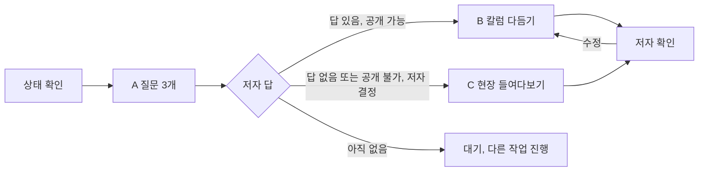

# drafting-interview: 현장 노트 인터뷰와 칼럼 절차

🛠 현장 노트는 이 시리즈에서 저자만 쓸 수 있는 유일한 요소입니다. 그래서 이 스킬의 일은 "쓰기"가 아니라 "묻고, 다듬고, 지키기"예요. 에이전트는 질문을 만들고, 저자가 준 답을 책에 실을 수 있는 모양으로 다듬고, 답이 없을 때 저자 경험처럼 읽히지 않는 대체물을 만듭니다. 어느 단계에서도 저자의 경험, 수치, 감정을 새로 만들지 않습니다(CLAUDE.md 11장, 1권 설계서 16.1절).

세부 규칙은 `references/`에 있고, 이 파일은 단계마다 무엇을 열지만 알려 드려요. reference는 필요한 단계에서만 엽니다.

## 1. 언제 쓰는가, 쓰지 않는가

쓰는 경우
- A단계: 장의 `interview.md`에 질문 3개 만들기(장 집필 사이클 ②, tasks.md 6장)
- B단계: 저자 답을 `index.md`의 `.box-field` 칼럼으로 다듬기(사이클 ⑦)
- C단계: 저자가 답하지 않기로 했거나 공개가 어려울 때 "현장 들여다보기"로 바꾸기(사이클 ⑦)
- 이미 다듬은 칼럼의 일반화 점검이나 문체 수정
- 3권 맺음말의 "저자의 마지막 현장 노트"(3권 설계서 5장 맺음말 설계) 질문 만들기. 공개 파일은 `vol3-physical-ai/epilogue-interview.md`, 날 답은 `_private/interviews/vol3-epilogue.md`

쓰지 않는 경우

| 작업 | 맡는 곳 |
|---|---|
| 장 본문, 다른 박스(📌 🧭 🏭 ❗), 자리 표시 박스 배치 | `writing-chapter` 스킬(`box-markup.md` 3.4절) |
| 현장 들여다보기에 쓸 공개 사례의 출처 수집, `references.yml` 항목 추가 | researcher 에이전트(`researching-chapter`) |
| 칼럼 포함 장 전체의 완료 판정 | reviewer 에이전트 |
| 저자 대신 답 쓰기, 답 초안 제시 | 하지 않음(5장) |

## 2. 절차 한눈에 보기

| 단계 | 입력 | 산출물 | 이때 여는 reference |
|---|---|---|---|
| 0. 상태 확인 | `interview.md`의 상태 칸, 요청 문장 | 이번에 할 단계(A, B, C) | `interview-format.md` 5장 |
| A. 질문 만들기 | 설계서 그 장의 "🛠 현장 노트 후보", 이 장이 답할 질문, 학습 목표, 절 목차 | `interview.md` 머리표, 질문 3개, 빈 답 칸 | `interview-format.md`, `question-design.md` |
| B. 칼럼 다듬기 | `_private/interviews/`의 날 답, 공개 점검 | `interview.md`의 일반화한 답과 다듬기 기록, `index.md`의 `.box-field` 칼럼 | `generalization.md`, `column-format.md`, `interview-format.md` 1장 |
| C. 현장 들여다보기 | 저자의 대체 결정, `references.yml` | 대체 박스 또는 출처 요청, `interview.md` 상태 갱신 | `look-inside.md` |

## 3. 단계별 절차

### 0단계: 상태 확인

`vol*/chNN/interview.md`를 열어 머리표의 "상태" 칸을 봅니다. 파일이 장 폴더 골격만 있는 상태(제목과 주석 한 줄)면 A단계부터예요. 요청과 상태가 맞지 않으면(예: 답 칸이 비었는데 "칼럼으로 다듬어 줘") 단계를 건너뛰지 말고 무엇이 비었는지 알려 줍니다. 상태 값과 바꾸는 사람은 `interview-format.md` 5장에 있습니다.

### A단계: 질문 3개 만들기

**열 것**: `references/interview-format.md`(파일 서식), `references/question-design.md`(좋은 질문 기준과 예시).

1. 해당 권 설계서 5장의 그 장에서 "🛠 현장 노트 후보", "이 장이 답할 질문", "학습 목표", 절 목차를 읽습니다. 후보가 "A, 또는 B"처럼 둘이면 질문 1에서 어느 쪽을 이야기할지 저자가 고르게 합니다.
2. 질문 3개를 `question-design.md` 2장의 역할 배치(장면, 판단, 독자에게 건넬 것)대로 만듭니다.
3. 각 질문을 `question-design.md` 3장 점검표 8항목으로 거릅니다. 특히 예/아니요로 끝나는 질문, 답을 미리 정해 둔 질문, 수치나 회사명을 요구하는 질문을 걸러 내요.
4. `interview-format.md` 3장 서식으로 `interview.md`를 씁니다. 답 칸은 비워 두고 예시 답이나 "예를 들면"을 넣지 않습니다. 견본이 저자 답처럼 굳어지기 때문이에요.
5. 상태를 `답변 대기`로 두고, 사용자에게 질문 3개와 함께 "답하기 쉬운 방식(구술, 키워드 메모 모두 가능)"과 날 답 위치(`_private/interviews/vol{권}-ch{NN}.md`, 커밋하지 않음)를 알립니다. 답은 `interview.md`가 아니라 그 파일이나 대화로 받습니다.

원고 `index.md`의 `.box-field` 자리 표시 박스는 `writing-chapter`가 둡니다. 박스가 없으면 이 스킬이 `box-markup.md` 3.4절의 자리 표시 서식 그대로 하나만 둘 수 있어요.

### B단계: 저자 답을 칼럼으로 다듬기

**열 것**: `references/generalization.md`(일반화 규칙표와 점검 명령), `references/column-format.md`(칼럼 서식, 화자, 다듬기 규칙), `references/interview-format.md` 1, 3, 4장(날 답 보관과 일반화한 답 서식).

시작 조건은 세 가지입니다. 날 답 파일(또는 대화)에 저자 답이 있고, 공개 가능 여부가 `공개 불가`가 아니며, 요청이 저자에게서 왔어야 해요. 하나라도 어긋나면 멈추고 묻습니다.

날 답은 커밋하지 않습니다. 고객사명, 금액, 기간이 섞인 원문은 git이 무시하는 `_private/interviews/`에만 두고, 커밋되는 `interview.md`에는 일반화한 답만 남겨요(`interview-format.md` 1장).

0. 날 답 위치를 확인합니다. `.gitignore`에 `/_private/`가 없으면 멈추고 사용자에게 알립니다. 저자가 `interview.md` 답 칸에 원문을 적었거나 대화로 답했으면, 다른 일보다 먼저 원문을 날 답 파일로 옮깁니다(`interview-format.md` 1, 4장).
1. 날 답을 읽고 `column-format.md` 2장 "근거 단위"로 나눕니다. 칼럼의 모든 문장은 이 단위 중 하나에서 나와야 합니다.
2. `generalization.md` 2장 규칙표로 일반화 대상을 찾아 바꾸고, 그 결과를 `interview.md` 답 칸에 날 답과 같은 번호의 일반화한 답으로 적습니다(`interview-format.md` 3장). 바꾼 항목은 일반화 목록에 원래 표현 없이 "범주, 바꾼 표현, 위치"만 남깁니다.
3. 답에 공개가 애매한 내용(분쟁, 계약, 특정인 평가, 보안 사고 세부)이 있으면 일반화한 답에는 "(뺌: 사유, 규칙 번호)"로, 칼럼에서는 빼고, "저자에게 확인할 것"에 원래 값 없이 위치와 범주로 올립니다. 에이전트가 넣을지 말지 정하지 않아요.
4. `column-format.md` 3, 4장 구조와 화자 규칙으로 2~5문단 칼럼을 씁니다. 장 본문 개념과 잇는 문장은 절 번호 참조 한 문장까지만 더할 수 있습니다.
5. `generalization.md` 4장 점검 명령을 박스와 `interview.md` 전체에 돌려 남은 고유명사, 숫자, 기간을 확인하고, `column-format.md` 6장 점검표를 통과시킵니다.
6. 상태를 `칼럼 초안`으로 바꾸고 저자에게 칼럼, 일반화 목록, 확인할 것을 함께 보여 줍니다. `저자 승인`은 저자만 적습니다.

### C단계: "현장 들여다보기"로 바꾸기

**열 것**: `references/look-inside.md`.

대체는 저자가 정합니다. 에이전트가 "답이 늦다"는 이유로 먼저 바꾸지 않아요(`box-markup.md` 3.4절). 저자가 "답하기 어렵다", "공개가 안 된다", "대체해 달라"고 말했을 때만 시작합니다.

1. 같은 주제의 공개 사례를 정합니다. 주제는 후보 주제가 던지는 질문을 그대로 두고 자료만 공개 사례로 바꿉니다. 같은 장 🏭 사례 박스와 같은 사례는 쓰지 않고, ❗ 박스와 같은 키를 쓰면 다른 claim을 씁니다(`look-inside.md` 2장).
2. 그 장 `references.yml`에서 쓸 키를 찾습니다. 쓸 키가 하나도 없으면 본문을 쓰지 않고, `look-inside.md` 3장 서식으로 출처 요청을 만들어 researcher에게 넘깁니다. 기억에 의존한 사례 해설은 쓰지 않아요.
3. 키가 있으면 `look-inside.md` 4장 서식으로 해설을 씁니다. 1인칭을 쓰지 않고, 모든 사실 문장에 `[@key]`를 붙이고, 첫 문단에서 공개 자료 해설임을 밝힙니다. 문장마다 그 키의 claim 문구와 견줘 claim보다 넓게 쓰지 않고("상당 부분" 대신 claim의 "중간 층에서 절반 넘게"), 칼럼 자리를 `where`에 둔 claim이 없으면 researcher에게 추가를 요청합니다. 1권 4장이 실제 예입니다(`look-inside.md` 7장).
4. 머리표 아래에 대체 결정 줄(날짜, 결정한 사람, 사유)을 적고, 상태 칸은 결과에 맞춥니다. 해설을 썼으면 `들여다보기 초안`, 키가 없어 출처 요청만 했으면 `대체 출처 대기`예요(`interview-format.md` 5장). `대체`는 결정만 받고 아직 C단계를 시작하지 않았을 때의 값입니다. 1권 4장은 해설을 쓰고도 상태를 "대체"로 적어 괄호로 풀어야 했어요. 질문 3개는 지우지 않습니다. 저자가 나중에 답하면 B단계로 되돌릴 수 있게 하기 위해서예요.

## 4. 출력 파일

| 파일 | 이 스킬이 하는 일 | 빌드 대상 |
|---|---|---|
| `vol*/chNN/interview.md` | 머리표, 질문 3개, 일반화한 답(A단계에서는 빈 답 칸), 공개 점검, 상태, 다듬기 기록, 일반화 목록, 확인할 것. 커밋되므로 원래 값을 두지 않음 | 아니요 |
| `_private/interviews/vol{권}-ch{NN}.md` | 저자 날 답. 저자가 쓰고, 에이전트는 구술을 받아 적거나 `interview.md`에 잘못 들어간 원문을 옮길 때만 씀. git 제외 | 아니요 |
| `vol*/chNN/index.md` | `.box-field` 박스 하나만 고칩니다(자리 표시 → 칼럼 또는 현장 들여다보기) | 예 |
| `vol*/chNN/notes.md` | C단계 기록(들여다보기 질문, 문단 구성, 쓴 키, 겹침 피하기, researcher 몫)을 남길 때만. 기존 절은 그대로 두고 끝에 덧붙이기만 함 | 아니요 |
| 사용자 응답 | 질문 목록, 일반화 목록, 확인할 것, 출처 요청 | 아니요 |

`index.md`에서 `.box-field` 밖은 고치지 않습니다. `references.yml`도 직접 쓰지 않고 출처 요청으로 넘겨요.

## 5. 하지 않는 일

| 하지 않는 일 | 대신 할 일 | 이유 |
|---|---|---|
| 현장 노트 본문 창작, 답 초안이나 견본 답 제시 | 질문만 만들고 답 칸을 비워 둠 | 저자 경험을 지어내면 책 전체의 신뢰가 무너집니다 |
| 저자 경력, 직함, 경험 연수, 소속을 지어내거나 추정 | 답에 있는 것만 쓰되 회사명과 정확한 연수는 일반화(G2, G18). 실리는 곳은 머리말 저자 소개뿐 | CLAUDE.md 2장, 11장 |
| 날 답이나 원래 고유명사, 숫자를 커밋되는 파일, 사용자 응답, 보고서, 커밋 메시지에 옮기기 | 날 답은 `_private/interviews/`에만 두고 위치로 가리킴 | 고객사와 소속 정보가 저장소 기록에 남으면 지울 수 없습니다 |
| 답에 없는 일화, 수치, 감정, 교훈 덧붙이기 | 빈 곳은 질문으로 돌려 저자에게 묻기 | 매끄럽게 하려고 넣은 한 문장이 사실처럼 굳습니다 |
| 고객사명, 금액, 기간, 수치를 그대로 두기 | `generalization.md` 규칙표대로 일반화 | CLAUDE.md 11장 |
| 저자 결정 없이 현장 들여다보기로 바꾸기 | 상태를 확인하고 저자에게 묻기 | 대체 여부는 저자 결정입니다 |
| 출처 없이 공개 사례 해설 쓰기 | 출처 요청을 researcher에게 넘김 | CLAUDE.md 8장 |
| 한빛로지스 세계관을 칼럼에 섞기 | 칼럼은 저자의 실제 현장만 다룸 | 가상 시나리오와 실제 경험이 섞이면 둘 다 믿기 어려워집니다 |
| 문서 버전 올리기, 일정이나 마감 적기 | 하지 않음 | CLAUDE.md 2장 |
| `.gitignore` 고치기 | `/_private/`가 없으면 사용자에게 알림 | 저장소 설정은 사용자가 정합니다 |

## 6. 막혔을 때

모호하면 추측하지 말고 저자에게 묻습니다. 질문에는 무엇이 모호한지, 어디서 확인하려 했는지(`interview.md` 질문 번호, 설계서 절), 선택지를 함께 적어요.

- 답이 질문과 다른 이야기를 함: 그 이야기가 후보 주제와 장 학습 목표에 닿으면 주제 문구를 바꾸자고 제안하고, 닿지 않으면 칼럼에 넣지 않고 저자에게 돌려 묻습니다
- 일반화하면 이야기가 성립하지 않음(예: 정확한 수치 차이가 핵심): 규모어로 바꾼 문장과 빼는 문장 두 안을 저자에게 보여 줍니다(`generalization.md` 3장)
- 답이 너무 짧아 2문단이 안 됨: 늘리지 말고 보충 질문 1~2개를 `interview.md`에 더합니다
- 설계서 후보 주제와 저자가 원하는 주제가 다름: 저자 주제를 따르고, 설계서 후보 문구 수정을 제안합니다
