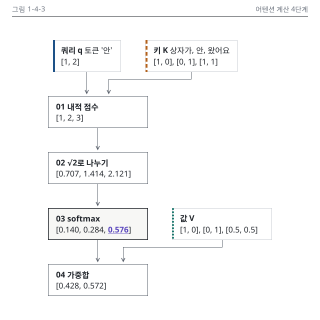

# 4장 작업 노트

## 그림

### 그림 1-4-3 시각 검수 (2026-10-15, writer)
- 판정: 통과 (고침 0, 저자 확인 0)
- 입력: 설계서 4장 명세 행(M), 정본 N4-2, 개념색 6.2절(쿼리 파랑, 키 주황, 값 청록 계열). 원고 4.2절은 아직 초고 전이라 설계서 절 목차로 문맥을 확인했습니다.
- 구성: 본문 판 `1-4-3.mmd`(TB, 노드 7, 연결선 6, 640 × 640), 세로 변형 `1-4-3.v.build.py`(S, 360 × 704)
- 렌더링: `render_mermaid.sh` 경고 0건. `--variant`로 시험한 360 자동 판은 내용 폭 448px가 328을 넘어 세로 변형만 S로 그렸습니다(choose-type.md 5장).
- lint: 본문 오류 0, 경고 2(Mermaid 배치 격자 이탈, 입력 상자 x 106, 291. 사유 기록 후 통과), 세로 변형 OK
- 정본 대조: 두 판 모두 "정본 행에 없는 소수" 없음. 정수 [1, 2], [1, 2, 3]은 PNG에서 N4-2 행과 눈으로 맞췄습니다.
- png: 첫눈에 03 softmax 메시지 상자와 0.576 밑줄로 갑니다. 겹침, 잘림, 두부 글자 없음. 단계 상자 4개 모두 200 × 64, 단계 사이 48.
- Q12 메시지 가리기: message를 보기 전에 적은 문장은 "키 순서상 세 번째인 왔어요가 가장 큰 가중치 0.576을 받습니다"였고, message와 같은 결론입니다.
- gray: 메시지 상자는 1.5px 진한 테두리와 면, 0.576은 밑줄로 한 곳만 두드러집니다. 쿼리는 실선 띠, 키는 파선 띠, 값은 점선 띠로 갈립니다.
- protan, deutan: 키 띠가 올리브로, 강조 밑줄이 파랑으로 바뀌지만 띠 선 종류와 밑줄 위치로 갈립니다. 근접 쌍 없음.
- w328: 본문 판의 16 라벨은 8.2 CSS px로 Q3 기준은 넘지만 벡터 숫자가 빽빽해 세로 변형을 둡니다. 세로 변형 w328은 가장 작은 글자 12.8 CSS px로 숫자 묶음이 모두 읽힙니다.
- 세로 변형(Q18): 노드, 숫자, 강조, 머리줄 대상 이름이 본문 판과 같고 높이 704(720 이하). 입력은 척추 x 40을 따라 단계 위 끝에 꽂히고 값 V는 04 단계 바로 위에 둡니다.
- dark: 카드 테두리 보임, 투명 구멍 없음.
- 세련됨: 같은 종류 시안(M 1-4-3)은 이번 작업에서 열지 않기로 해 design-rules.md 9장 12가지 기준으로만 대조했습니다. 머리줄 자리, 정렬선 4개(x 96, 106, 291, 344), 같은 역할 같은 크기, 강조가 흐름의 결과 자리, 선 굵기 1과 1.5, 오른쪽 빈 곳, 글자 크기 14와 16 두 가지, 개념색은 띠에만 있어 어긋난 줄이 없습니다.

### 그림 1-4-3 이미지 줄 (writing-chapter에 넘김, 4.2절 네 단계 손계산 뒤)

```markdown
{#fig:1-4-3 alt="토큰 '안'의 어텐션 계산을 내적 점수, 루트 2로 나누기, softmax, 가중합의 네 단계 흐름도로 나타냈습니다. 쿼리 [1, 2]와 세 키의 내적 점수 [1, 2, 3]을 루트 2로 나누면 [0.707, 1.414, 2.121]이 됩니다. softmax를 거친 가중치는 상자가 0.140, 안 0.284, 왔어요 0.576이고, 이 가중치로 값을 섞은 출력은 [0.428, 0.572]입니다. 가중치가 가장 큰 왔어요의 정보를 '안'이 가장 많이 가져옵니다."}
```
