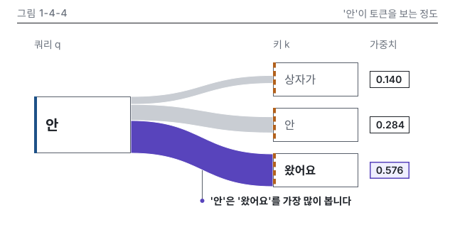

# 4장 작업 노트

### 그림 1-4-4 시각 검수 (2026-10-15, writer)
- 판정: 통과 (고침 0, 저자 확인 0)
- lint: 오류 0, 경고 0(두 판 모두) / build_charts 경고 2: 세로 변형 상자 폭 72, 88이 최소 폭 120 미만. P8 세로 변형 실측 치수라 사유로 남김
- 칩 대조: 3개 일치(N4-2), 정본 행에 없는 소수 0
- Q12 메시지 가리기: 그림만 보고 적은 문장은 "'안'은 '왔어요'에 가장 큰 가중치를 줍니다"이고 message와 같은 말입니다
- png: 왔어요로 가는 띠와 칩 0.576이 먼저 보임. 겹침, 잘림 없음. 지시선 위 끝이 강조 띠 아래 끝에 닿음(확대 확인)
- gray: 강조 띠가 가장 진하고 넓음. 칩은 1.5px 테두리로 갈림. 키 상자는 파선 띠, 쿼리 상자는 실선 띠로 갈림
- protan, deutan: 강조 띠가 파랑으로, 키 띠가 올리브로 바뀌나 면적, 칩 테두리, 파선으로 갈림
- w328: 지시선 글과 칩(14)이 7.2 CSS px라 본문 판만으로는 부족해서, 세로 변형을 만들었습니다(choose-type 5장 3번)
- v, v.w360, v.w328: 숫자, 문구, 강조, 머리줄 대상 이름이 본문 판과 같음. 가장 작은 글자 12.8 CSS px, 높이 320
- dark: 카드 테두리 보임, 투명 구멍 없음
- 세련됨: 1-4-4 시안은 열지 않았고(작업 지시), 1-5-5 시안과 머리줄, 칩, 메시지 지시선 문법을 대조했습니다. 9장 12개 기준 모두 맞음(왼쪽 끝 x는 48, 384, 520의 3줄, 키 상자 3개 120 x 48, 칩 3개 56 x 24, 글자 크기 14, 16, 20 세 종류이고 20은 쿼리 '안' 한 곳)

이미지 줄(writing-chapter에 넘김, 4.2절 손계산 뒤)

{#fig:1-4-4 alt="토큰 '안'이 상자가, 안, 왔어요를 얼마나 보는지를 연결 띠의 굵기로 나타냈습니다. 가중치는 상자가 0.140, 안 0.284, 왔어요 0.576이고 셋을 더하면 1입니다. 가장 굵은 띠가 왔어요로 이어져, '안'은 '왔어요'를 가장 많이 봅니다."}
