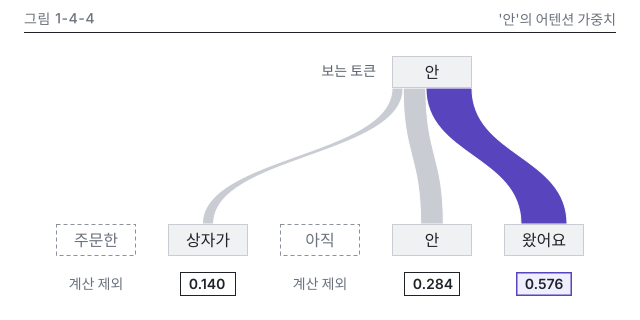

# 4장 작업 노트

## 그림 1-4-4 검수 기록

- 소스: `figures/1-4-4.build.py`(figkit, concepts.py). 출력은 `1-4-4.svg`(640 x 320)와 `1-4-4.v.svg`(360 x 296)입니다.
- 메시지: '안'은 '왔어요'를 가장 많이 봅니다. 강조는 '왔어요' 띠와 칩 0.576 두 곳입니다.
- 정본: N4-2 softmax 결과 0.140, 0.284, 0.576을 칩에 글자 그대로 옮겼고, 칩마다 `data-canon="N4-2"`를 달았습니다.
- 띠 폭: 가중치 1.0 = 80, 띠 세 개가 출발 변 80을 빈틈없이 나눕니다. 가장 가는 띠(0.140)는 11.2라 하한 4를 넘습니다.
- lint: 두 판 모두 오류 0, 경고 0입니다. `figure_qa.py` 경고도 0입니다.
- 미리보기: `figures/_render/qa/`에 컬러, 흑백, 제1색약, 제2색약, 다크 카드, 폭 328, 세로 변형 360을 만들었어요.
- 눈으로 본 결과: 흑백과 색약 보기에서도 강조 띠가 하나로 보이고, 폭 차이로 순위가 읽힙니다. 본문 폭을 328로 줄이면 글자가 약 7 CSS px라 세로 변형을 두었습니다.

## 저자 확인이 필요한 점

- 토큰 분할: 그림 1-2-1이 아직 없어 concepts.py 미리보기의 '주문한 | 상자가 | 아직 | 안 | 왔어요'를 썼습니다. 1-2-1이 확정되면 맞춰 봐야 해요.
- N4-2 손계산은 세 토큰만 쓰므로 '주문한'과 '아직'은 파선 테두리와 '계산 제외' 글자로 두었습니다. 다섯 토큰 모두 가중치가 있는 정본(N4-2 확장)을 원하면 설계서 7장 추가안이 먼저 필요합니다.
- 쿼리, 키 개념색 띠는 넣지 않았습니다. 이 그림의 메시지는 가중치 크기라서 중립색과 강조색만 썼습니다.
- 다섯 토큰 한 줄이라 왼쪽 끝 x가 5개(5.4절 상한과 같음)입니다.
- status는 `rendered`입니다. 독립 검수 뒤 `reviewed`로 올립니다.

## 원고 이미지 줄(4.2절에 넣을 사본)

{#fig:1-4-4 alt="러닝 예문 '주문한 상자가 아직 안 왔어요'에서 토큰 '안'이 다른 토큰을 보는 정도를 띠로 나타냈고, 띠 폭이 가중치입니다. 손계산에 쓴 세 토큰의 가중치는 상자가 0.140, 안 0.284, 왔어요 0.576이고 합은 1입니다. '주문한'과 '아직'은 계산에서 뺐습니다. '안'은 '왔어요'를 가장 많이 봅니다."}
