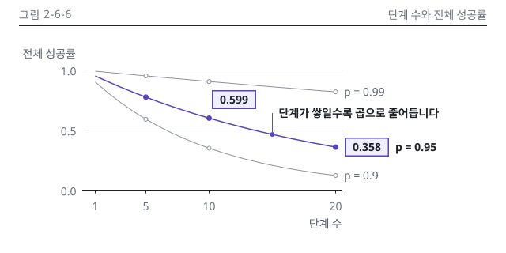

# 6장 작업 노트

### 그림 2-6-6 시각 검수 (2026-10-15, writer)
- 판정: 통과 (고침 0, 저자 확인 1)
- lint: figlib OK, figkit OK(본문, 세로 변형), build_charts --strict 경고 0 / 칩 대조: 2개 일치(0.599, 0.358, N6-1), 정본 밖 소수는 눈금 0.0과 1.0뿐
- png: p = 0.95 선과 칩 0.599, 0.358이 먼저 보임. 겹침과 잘림 없음. 메시지 가리기 시험에서 "p가 0.95여도 단계가 늘면 성공률이 크게 줄어든다"로 읽혀 message와 같음
- gray: 강조 선이 가장 진하고 굵으며 채운 점, 맥락 선 둘은 연하고 속 빈 점. 세 선은 선 끝 라벨로 갈림
- protan, deutan: 강조 선이 파랑으로 바뀌나 굵기와 채운 점으로 한 곳에 남음
- w328: 칩과 선 이름이 약 7.2 CSS px라 세로 변형 2-6-6.v.svg(360 × 392)를 둠. v.w360에서 칩 숫자와 라벨 읽힘, 숫자와 강조는 본문 판과 같음
- dark: 카드 테두리 보임, 투명 구멍 없음
- 세련됨: 시안 1-5-5와 대조. 그림 영역 왼쪽 104, 오른쪽 432와 직접 라벨 열, 눈금 3개, 강조 3군데(선, 칩 2)로 같은 손. 본문 판 그림 영역 아래만 가로축 제목 때문에 240(견본 example-log-n6-1과 같은 판)
- 설계 판단: 선은 정본 식 p^n을 정수 단계 1~20에서 계산해 직선으로 이음. 점은 정본 단계 5, 10, 20에만(1단계는 세 점이 약 7px 간격으로 붙어 생략)
- 저자 확인: 메시지 지시선 점이 정본 점이 아닌 선 위 중간점(본문 15단계, 세로 변형 3단계)이라 데이터 점으로 오해될 여지가 있음. 정본 점(5, 10단계)에는 깨끗한 자리가 없었음. 세로 변형은 지시선 문장이 세로축 제목과 같은 줄에 놓임(간격 8 이상)

이미지 줄(writing-chapter에 넘김)

{#fig:2-6-6 alt="단계마다 서로 독립적으로 성공률 p로 성공한다고 할 때, 단계 수 1~20에 따른 전체 성공률을 p = 0.99, 0.95, 0.9 세 선으로 나타냈습니다. p = 0.99는 10단계 0.904, 20단계 0.818로 완만히 줄고, p = 0.9는 20단계에 0.122까지 떨어집니다. p = 0.95는 10단계 0.599를 거쳐 20단계 0.358까지 내려가, 단계가 쌓일수록 전체 성공률이 곱으로 줄어듭니다."}
