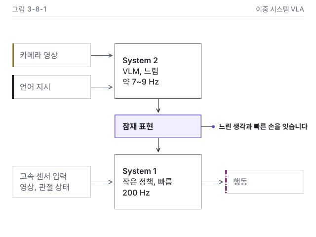

# 8장 작업 노트

### 그림 3-8-1 시각 검수 (2026-10-15, writer)
- 판정: 통과 (고침 0, 저자 확인 1: 출처 키)
- lint: 오류 0, 경고 0 (3-8-1.svg, 3-8-1.v.svg) / 칩 대조: 칩 없음(주기는 🔄 관리표 값이라 보통 글자), 소수 없음
- png: 잠재 표현 상자가 먼저 보이고 지시선이 그 오른쪽에 하나, 겹침과 잘림 없음
- gray: 잠재 표현은 1.5px 테두리와 옅은 면으로 한 곳만 두드러짐. 카메라 영상은 이중 실선 띠, 언어 지시는 진한 실선 띠, 행동은 1점 쇄선 띠, 고속 센서 입력은 띠 없음으로 갈림
- protan, deutan: 강조가 파랑 계열로 바뀌나 테두리 굵기로 한 곳. exemptions 근접 쌍 없음
- w328: 모듈 라벨과 주기가 8.2 CSS px라 세로 변형 사용(note 기록). v.w328은 가장 작은 글자 11.5 CSS px
- dark: 카드 테두리 보임, 투명 구멍 없음
- 세로 변형: 폭 400 × 488, 글자, 주기, 메시지, 강조, 머리줄 대상 이름이 본문 판과 같음
- 메시지 가리기(Q12): 그림만 보고 적은 문장 "느린 System 2가 낸 잠재 표현을 빠른 System 1이 센서 입력과 합쳐 행동으로 바꾼다"가 message와 같은 말
- 세련됨: 시안 1-4-4와 대조. 왼쪽 끝 x 24, 232, 456의 3줄, 같은 역할 상자 같은 크기(입력 160 × 48, 모듈 176 × 112), 선 굵기 1, 1.5, 4, 글자 크기 14, 16 두 가지, 오른쪽 위 빈 곳 남김. 9장 12개 중 어긋남 없음
- Q24(로봇 닮음), Q26(데모 표시 줄): 로봇과 데모 장면이 없어 해당 없음
- 저자 확인: 주기의 출처 키 figure2025helix가 장 references.yml과 서지 마스터에 없음. researcher가 키를 넣은 뒤 캡션에 자료 줄을 둘지 정해 주세요

이미지 줄(writing-chapter에 넘김, 8.2절 자리):

{#fig:3-8-1 alt="이중 시스템 VLA의 구조를 위아래 두 층으로 나타냈습니다. 위층의 System 2는 VLM으로 만든 느린 모듈이고, 카메라 영상과 언어 지시를 받아 약 7~9 Hz로 잠재 표현을 냅니다. 아래층의 System 1은 작은 정책으로 만든 빠른 모듈이고, 이 잠재 표현과 고속 센서 입력(영상, 관절 상태)을 받아 200 Hz로 행동을 냅니다. 느린 System 2와 빠른 System 1을 잠재 표현이 잇습니다."}
