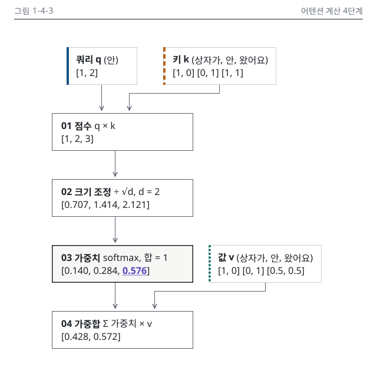

# 4장 작업 노트

### 그림 1-4-3 시각 검수 (2026-10-15, writer)
- 판정: 통과 (고침 0, 저자 확인 0)
- 메시지 가리기(Q12): message를 보기 전 적은 문장은 "'안'의 가중치는 '왔어요'가 가장 크고, 그 가중치로 값을 섞어 출력이 나옵니다". message와 같은 말입니다.
- lint: 1-4-3.svg 오류 0, 경고 3(격자 이탈 rect (113, 80), (277, 80), (354, 416), Mermaid 배치. 사유: ELK가 입력 상자 x를 정하며 시안과 같은 경고 수). 1-4-3.v.svg 오류 0, 경고 0
- 렌더링: render_mermaid.sh 경고 0건(640 × 640, 노드 7, 연결선 6). --variant 360은 "내용 폭 458px가 캔버스 내용 폭 328px를 넘음"이라 세로 변형을 1-4-3.v.build.py(S)로 다시 그림. build_charts.py --strict 통과(360 × 696)
- 정본 대조: 칩 없음. 소수 대조 출력 없음(두 판 모두 N4-2 행 안). 정수 1, 2, 3과 입력 벡터는 PNG에서 정본 표와 눈으로 맞춤
- 치수(SVG 실측): 본문 주 열 x 88에 240 x 64 넷, 입력 q 120 x 64, k와 v 192 x 64. 세로 변형 단계 x 16에 328 x 64 넷, 입력 x 56에 288 x 64 셋. P1 표(주 열 240 x 64, 세로 변형 328, 입력 288)와 같음
- png: 처음 눈이 가는 곳은 03 가중치 상자의 굵은 테두리와 0.576 밑줄. 겹침, 잘림, 두부 글자 없음. 연결선은 직각, 꺾임 2회 이하, 교차 0
- gray: 03 상자의 굵은 테두리와 면, 0.576 밑줄이 한 덩어리로 남음. q는 실선 띠, k는 파선 띠, v는 점선 띠로 갈림
- protan, deutan: 키 띠가 올리브로 바뀌지만 파선으로 갈리고, 강조 0.576은 개념색과 뭉치지 않음
- w328: 본문 판 라벨이 8.2 CSS px라 세로 변형을 씀. 세로 변형은 가장 작은 글자 12.8 CSS px로 기준 이상
- v.w360, v.w328: 숫자, 메시지, 강조, 머리줄 대상 이름이 본문 판과 같음. 높이 696으로 720 이하
- dark: 카드 테두리 보임, 투명 구멍 없음
- 캡션과 alt: caption-alt.md 7장 명령 통과. SVG desc가 두 판 모두 alt와 글자 단위로 같음
- 세련됨: design-rules.md 9장 12가지를 mermaid-guide.md 2장 본보기와 P1 실측 값에 대조해 어긋남 없음. 오른쪽 열은 입력 상자 말고 비어 있고, 글자 크기는 14와 16 두 가지

이미지 줄(writing-chapter에 넘김, 4.2절 네 단계 손계산 문단 뒤)

{#fig:1-4-3 alt="토큰 '안'의 어텐션 계산을 점수, 크기 조정, softmax, 가중합의 네 단계 흐름도로 나타냈습니다. 점수 1, 2, 3은 루트 2로 나누면 0.707, 1.414, 2.121이 되고, softmax를 거친 가중치는 상자가 0.140, 안 0.284, 왔어요 0.576입니다. 이 가중치로 값을 섞은 출력은 0.428과 0.572로, '안'은 '왔어요'의 정보를 가장 많이 가져옵니다."}
