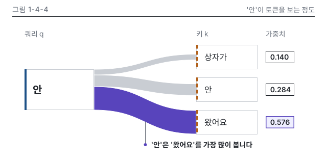

# 4장 작업 노트

### 그림 1-4-4 시각 검수 (2026-10-15, writer)
- 판정: 통과 (고침 0, 저자 확인 0)
- 입력: 1권 설계서 4장 그림 명세 1-4-4(S), 정본 N4-2(softmax [0.140, 0.284, 0.576]), 패턴 P8(1-4-4 실측 치수)
- lint: 1-4-4.svg, 1-4-4.v.svg 모두 오류 0, 경고 0 / 칩 대조: 3개 일치, 정본 행에 없는 소수 없음
- 빌드 경고: 세로 변형의 상자 폭 72(쿼리), 88(키 3개)이 최소 폭 120보다 작다는 경고 4건입니다. P8 세로 변형 실측 치수를 따른 결과라 그대로 둡니다
- 치수(SVG 실측): 본문 쿼리 136 x 80(x 48), 키 120 x 48 셋(x 384), 칩 56 x 24 셋(x 520). 세로 변형 쿼리 72 x 80(x 16), 키 88 x 48 셋(x 184), 칩 56 x 24 셋(x 280). P8 표와 같습니다
- Q12 메시지 가리기: 그림만 보고 "'안'은 '왔어요'로 가는 연결이 가장 굵다"고 읽혀 message와 같습니다
- png: 강조 띠와 칩 0.576이 먼저 보이고, 겹침과 잘림은 없습니다. 띠 셋이 쿼리 상자 오른쪽 변을 빈틈없이 나눕니다
- gray: 강조 띠가 가장 진하고 넓습니다. 쿼리는 실선 띠, 키는 파선 띠로 갈립니다
- protan, deutan: 강조는 파랑, 키 띠는 올리브로 바뀌지만 면적과 파선, 칩 테두리 굵기로 갈립니다
- w328: 칩 숫자는 읽히나 열 머리와 토큰 이름이 7.2~8.2 CSS px라 세로 변형을 함께 만들었습니다(note 기록)
- v.w360, v.w328: 숫자, 메시지, 강조, 머리줄 대상 이름이 본문과 같고 높이 320입니다. 지시선은 강조 칩 아래에서 내려 글자를 점 왼쪽에 둡니다
- dark: 카드 테두리가 보이고 투명 구멍은 없어요
- 세련됨: 같은 장 시안 1-4-3과 머리줄, 입력 상자 테두리, q 실선 띠와 k 파선 띠 표기를 대조했고 9장 12개 기준에서 어긋남이 없습니다. 정렬선 3줄(48, 384, 520), 글자 크기 3종(14, 16, 20은 쿼리 '안' 한 곳)
- 캡션, alt 점검(caption-alt.md 7장 명령): 통과, 캡션 101자, SVG desc 두 판 모두 alt와 같습니다

이미지 줄(writing-chapter에 넘김):
{#fig:1-4-4 alt="토큰 '안'이 상자가, 안, 왔어요를 얼마나 보는지를 연결 띠의 굵기로 나타냈습니다. 가중치는 상자가 0.140, 안 0.284, 왔어요 0.576이고 셋을 더하면 1입니다. 가장 굵은 띠가 왔어요로 이어져, '안'은 '왔어요'를 가장 많이 봅니다."}
