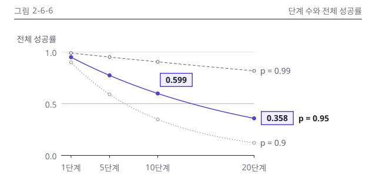

# 6장 작업 노트

## 그림 검수 기록

### 그림 2-6-6 시각 검수 (2026-10-15, making-figures)
- 판정: 통과 (고침 0, 저자 확인 1: 가로축 눈금 글자에 단위 붙임)
- 입력: 2권 설계서 6장 그림 명세 2-6-6(C), 정본 N6-1(E6-1, 독립 가정). 원고 6.5절은 아직 없어 설계서 6.5절 행(A5, E6-1)으로 문맥을 확인했습니다.
- 메시지 가리기(Q12): message를 보기 전에 적은 문장은 "p = 0.95면 20단계에서 0.358까지 떨어지고, 단계가 늘수록 세 곡선이 모두 내려간다"였고, message와 같은 뜻입니다.
- lint: build_charts --strict 오류 0, 경고 0 / figkit lint, figlib lint 모두 OK(본문, 세로 변형)
- 칩 대조: 2개 일치(N6-1 0.599, 0.358). 정본 행에 없는 소수는 축 눈금 0.0, 1.0뿐입니다.
- 치수(SVG 실측): 캔버스 640 x 320, 그림 영역 x 104~432, y 88~264로 P15 표와 같습니다. 세로 변형은 360 x 328, 영역 x 56~272, y 88~280입니다. 상자 그림이 아니라 Q8 열별 상자 대조는 해당 없음.
- png: p = 0.95 곡선과 칩 두 개가 먼저 보입니다. 선 끝 라벨 간격이 넉넉하고 글자와 선의 겹침, 잘림이 없습니다.
- gray: 메시지 곡선이 가장 진하고 굵은 실선으로 남고, p = 0.99는 파선, p = 0.9는 점선으로 갈립니다. 강조 칩은 테두리 굵기로 구분됩니다.
- protan, deutan: 강조색이 파랑으로 바뀌지만 맥락 선은 회색 파선과 점선이라 뭉치지 않습니다.
- w328: 본문 판의 칩 숫자가 7.2 CSS px라 Q3 기준에 못 미칩니다. 그래서 같은 스크립트로 세로 변형을 만들었고, v.w328에서 칩과 라벨이 12.8 CSS px로 읽힙니다.
- v.w360: 숫자, 강조, 머리줄 대상 이름이 본문 판과 같습니다. 끝 칩만 점 오른쪽 위로 옮겼습니다. 1단계와 5단계 눈금 글자 사이가 좁지만 겹치지 않습니다.
- dark: 카드 테두리가 보이고 투명 구멍이 없습니다.
- 세련됨: 시안 1-5-5와 대조했고, 9장 12개 기준 중 어긋남은 없습니다. 시안과 다른 점은 둘입니다. 맥락 선 둘을 rank 1, 2(파선, 점선)로 나눈 것은 chart-guide 4.2절 규칙을 따른 것이고, 지시선을 뺀 것은 기준 8(지시선 0~1개)에 들어갑니다.
- 저자 확인: 가로축을 "5단계"처럼 눈금 글자에 단위를 붙여 나타냈습니다. style-guide 6.5절 "축 단위는 축 제목에 한 번"과 겹쳐 확인이 필요해요. 캡션 읽는 법과 대체 텍스트에서도 가로축이 단계 수임을 밝혀 두었습니다.

이미지 줄(writing-chapter에 넘김)

```markdown
{#fig:2-6-6 alt="단계 수 1부터 20까지 전체 성공률이 줄어드는 모습을 단계별 성공률 p = 0.99, 0.95, 0.9의 세 곡선으로 나타냈습니다. 가로축은 단계 수, 세로축은 전체 성공률이고, 강조한 곡선은 p = 0.95입니다. 이 곡선은 10단계에서 0.599, 20단계에서 0.358로 떨어지고, p = 0.99도 20단계에서 0.818까지 내려갑니다. 단계가 늘수록 전체 성공률은 곱으로 빠르게 떨어집니다."}
```
