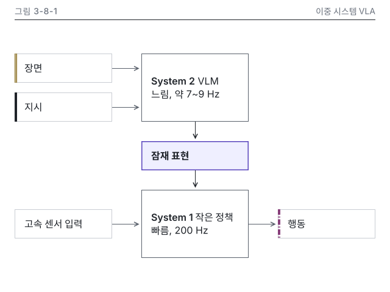

# 8장 작업 노트

### 그림 3-8-1 시각 검수 (2026-10-15, making-figures)
- 판정: 통과 (고침 0, 저자 확인 0)
- 메시지 가리기(Q12): 메시지를 보기 전에 적은 문장 "느리게 도는 System 2가 잠재 표현을 내고, 빠르게 도는 System 1이 그것과 센서 입력으로 행동을 냅니다". message와 같은 말입니다
- lint: 본문 판, 세로 변형 모두 오류 0, 경고 0 / figure_qa: 오류 0, 경고 0 / 칩: 없음(주기는 🔄 관리표 값이라 칩을 달지 않음)
- 치수(SVG 실측, 테두리 바깥 끝): 본문 x 24 열 160 x 48 셋(장면, 지시, 고속 센서 입력), x 232 열 176 x 112 둘(System 2, System 1)과 176 x 48 하나(잠재 표현, accent 종류), x 456 열 160 x 48 하나(행동). P9 표 값(입출력 160 x 48, 블록 폭 176)과 같습니다. 세로 변형 x 16 열 152 x 48 셋과 328 x 64 둘, x 192 열 152 x 48 둘. 와이어프레임 156 x 48(사이 16)은 8 격자 밖이라 152(사이 24)로 바꿨고 note에 적었습니다
- 왼쪽 끝 x 값: 본문 24, 232, 456의 3개, 세로 변형 16, 192의 2개
- png: 잠재 표현 상자(accent 테두리와 tint 면)가 먼저 보입니다. 겹침, 잘림, 두부 글자 없음. 연결선은 모두 곧은 선이고 교차 없음
- gray: 잠재 표현은 회색 면과 1.5px 테두리로 한 곳만 갈립니다. 장면은 이중 실선 띠, 지시는 실선 띠, 행동은 1점 쇄선 띠, 고속 센서 입력은 띠 없음으로 갈립니다
- protan, deutan: accent가 파랑으로 바뀌지만 여전히 한 곳이고, 개념 띠는 선 종류로 갈립니다. 근접 쌍(exemptions) 해당 없음
- w328: 라벨 8.2 CSS px로 작아 세로 변형을 둡니다(choose-type 5장 3번, 선택)
- 세로 변형 v.png, v.w360, v.w328: 높이 472, 숫자, 메시지, 강조, 머리줄 대상 이름이 본문 판과 같습니다. 입력은 늘 위에서 들어와 읽는 방향이 뒤집히지 않습니다. 가장 작은 글자 12.8 CSS px
- dark: 카드 테두리 보임, 투명 구멍 없음
- 정본과 🔄: 약 7~9 Hz, 200 Hz가 N8-1과 🔄 관리표 Figure Helix 행 문자열과 같고, 그림 안 기준일 없음. 캡션 기준일 2026년 10월과 refresh.as_of가 같습니다
- 로봇, 데모 장면(Q24, Q26): 해당 없음
- 세련됨: 시안 1-4-4와 대조, 9장 12개 중 어긋남 없음. 8번은 지시선 없이 강조 상자로 대신했습니다(오른쪽 위 빈 곳은 7번의 여백으로 둠)

이미지 줄(writing-chapter에 넘김, 8.2절):

```
{#fig:3-8-1 alt="이중 시스템 VLA를 System 2, 잠재 표현, System 1, 행동으로 이어지는 블록도로 나타냈습니다. VLM인 System 2는 장면과 지시를 받아 약 7~9 Hz로 느리게 잠재 표현을 냅니다. 작은 정책인 System 1은 이 잠재 표현과 고속 센서 입력을 받아 200 Hz로 빠르게 행동을 냅니다. 느린 System 2의 잠재 표현을 빠른 System 1이 행동으로 바꿉니다."}
```

남은 일: 출처 키 figure2025helix가 ch08 references.yml에 없습니다. 캡션에 출처 줄과 회사명을 넣으려면 researcher가 키를 등록해야 하고, 지금은 source.kind own으로 두었어요.
