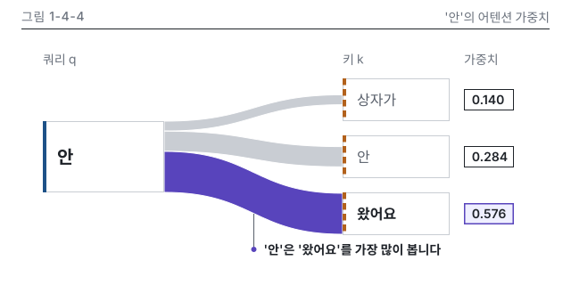

# 4장 작업 노트

### 그림 1-4-4 시각 검수 (2026-10-15, writer)
- 판정: 통과 (고침 0, 저자 확인 1: 토큰 분할)
- lint: 오류 0, 경고 0 (본문, 세로 변형) / figure_qa: 오류 0, 경고 0 / 칩 대조: 3개 일치, 정본 행에 없는 소수 0
- 빌드 경고: 세로 변형 상자 폭 72, 88이 figkit 최소 폭 120보다 작다는 UserWarning 2건. P8 세로 변형 실측 치수라 그대로 둡니다
- 치수(SVG 실측): 본문 쿼리 x 48 136 x 80, 키 x 384 120 x 48 셋, 칩 x 520 56 x 24 셋. 세로 변형 쿼리 x 16 72 x 80, 키 x 184 88 x 48 셋, 칩 x 280. P8 표와 같음
- png: 강조 띠와 칩 0.576이 먼저 보이고, 겹침이나 잘림은 없습니다. 띠 사이 1px 흰 틈으로 출발점이 갈라 보입니다
- Q12 메시지 가리기: 그림만 보고 "안은 왔어요 쪽으로 가장 굵게 이어진다"고 읽혀 message와 같습니다
- gray: 강조 띠가 가장 진하고 넓습니다. 쿼리는 실선 띠, 키는 파선 띠로 갈립니다
- protan, deutan: 강조 띠가 파랑으로, 키 띠가 올리브로 바뀌지만 면적과 칩 테두리, 파선으로 갈립니다
- w328: 칩 숫자는 읽히나 토큰 이름이 약 8 CSS px라 세로 변형을 만들었습니다(note 기록)
- v.w360, v.w328: 숫자, 메시지, 강조, 머리줄 대상 이름이 본문과 같고 높이 320입니다. 지시선 글과 왔어요 상자 사이를 띄우려고 지시선 길이를 24에서 32로 고쳤습니다
- dark: 카드 테두리가 보이고 투명 구멍은 없습니다
- 세련됨: 같은 종류 시안(1-4-4)은 열 수 없어 1-4-8 PNG와 대조하고, design-rules 9장 표의 1-4-4 관찰값을 줄마다 확인했습니다. 정렬선 48, 384, 520 세 줄(2번), 키 상자와 칩 같은 크기(3번), 비강조 띠 ink-200과 키 라벨 400 ink-600(5번), 선 굵기 1, 1.5, 4(6번), 20 글자는 쿼리 안 한 곳(10번) 모두 맞아 어긋남이 없습니다
- 저자 확인: 러닝 예문 토큰 분할은 1-2-1에서 정하지만 아직 없습니다. 이 그림은 정본 N4-2의 토큰 셋만 그리므로 1-2-1 확정 뒤 상자가, 안, 왔어요가 그 분할과 맞는지 한 번 대조해 주세요

이미지 줄(writing-chapter 인계용):

{#fig:1-4-4 alt="토큰 '안'이 상자가, 안, 왔어요를 얼마나 보는지를 연결 띠의 굵기로 나타냈습니다. 가중치는 상자가 0.140, 안 0.284, 왔어요 0.576이고 세 띠의 굵기를 합하면 쿼리 상자 한 변과 같습니다. 가장 굵은 띠가 왔어요로 이어져, '안'은 '왔어요'를 가장 많이 봅니다."}
