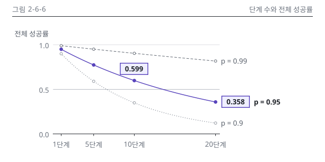

# 6장 작업 노트

## 그림 2-6-6

### 입력 메모
- 명세: 2권 설계서 6장 그림 명세 2-6-6(C). 단계 수에 따른 전체 성공률 곡선, p = 0.99, 0.95, 0.9 세 줄(N6-1). 강조 선은 p = 0.95
- 정본: N6-1(1, 5, 10, 20단계). p=0.99 → 0.99, 0.951, 0.904, 0.818 / p=0.95 → 0.95, 0.774, 0.599, 0.358 / p=0.9 → 0.9, 0.590, 0.349, 0.122. 식은 E6-1(p^n, 독립 가정)
- 위치: 6.5절 "데모와 운영 사이: 오류 누적과 비용 누적". 🔄 아님
- 패턴: P15 차트 판(640 x 320, 그림 영역 x 104~432, y 88~264), 세로 변형은 1-5-5.v 판(360 x 368, 영역 x 64~264, y 128~320)

### 그림 2-6-6 시각 검수 (2026-10-15, making-figures)
- 판정: 통과 (고침 0, 저자 확인 1: 가로축 눈금 단위 표기)
- lint: figkit, figlib 모두 OK(본문, 세로 변형) / figure_qa 오류 0, 경고 0 / 빌드 `-W error::UserWarning` 경고 0
- 칩 대조: N6-1 칩 2개(0.599, 0.358) 일치. 정본 행에 없는 소수는 눈금 0.0, 1.0뿐
- 치수(SVG 실측): 캔버스 640 x 320, 강조 칩 56 x 24 둘(본문 x 236, 436). 선 굵기는 1과 1.5만. 상자 없음
- 고친 이력: 첫 판은 5단계 점에서 메시지 지시선을 냈으나 지시선이 p = 0.99 선과 점을 가로질러 뺐습니다. 세로 변형의 10단계 칩은 점 위(above)에서 왼쪽 아래 모서리가 곡선에 닿아 오른쪽 위로 옮겼습니다
- png: p = 0.95 곡선과 칩 0.358이 먼저 보임. 글자와 선 겹침, 잘림 없음. 1단계의 세 점은 가깝지만 겹치지 않음
- gray: 강조 선은 실선과 채운 점, p = 0.99는 파선, p = 0.9는 점선으로 갈림. 칩 두 개가 강조로 남음
- protan, deutan: 강조색이 파랑으로 바뀌나 실선, 채운 점, 칩 테두리로 한 덩어리 유지
- w328: 칩 숫자가 7.2 CSS px로 작아 세로 변형을 둠(note 기록)
- v, v.w360, v.w328: 숫자, 강조, 머리줄 대상 이름이 본문과 같음. 1단계와 5단계 눈금 글자가 겹치지 않음. 높이 368
- dark: 카드 테두리 보임, 투명 구멍 없음
- Q12: 메시지를 가리고 본 인상은 "단계가 늘수록 성공률이 곱으로 줄고, 0.95도 20단계면 0.358까지 떨어진다"로 `message`와 같음
- 세련됨: 시안 1-5-5와 대조, 9장 12개 중 어긋남 없음. 다른 점은 지시선 0개(8번 허용 범위)와 맥락 선을 rank 1, 2로 가른 것(chart-guide 4.2절 규칙)

### 원고 이미지 줄 (writing-chapter에 넘김)

```markdown
{#fig:2-6-6 alt="단계마다 같은 성공률 p로 독립적으로 성공한다고 할 때, 단계 수 1에서 20까지의 전체 성공률을 p = 0.99, 0.95, 0.9 세 곡선으로 나타냈습니다. 세 곡선 모두 단계가 늘수록 내려가고, p가 낮을수록 더 가파르게 떨어집니다. 강조한 p = 0.95 곡선은 10단계에서 0.599, 20단계에서 0.358이고, 같은 20단계에서 p = 0.99는 0.818입니다. 단계 성공률이 0.95여도 20단계면 전체 성공률은 0.358로 떨어집니다."}
```

### 저자 확인
- 가로축 눈금을 "5단계"처럼 단위를 붙여 썼습니다. 320 판에는 가로축 제목 자리가 없어 chart-guide 4.2절 제안안을 따랐고, style-guide 6.5절 "단위는 축 제목에 한 번"과 겹치는 부분은 승인을 기다립니다
