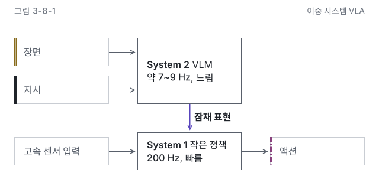

# 8장 작업 노트

## 그림 입력 메모

### 그림 3-8-1 이중 시스템 개념도
- 명세: 3권 설계서 8장 그림 명세 3-8-1(S). 🔄 관리표 8.3 Figure Helix 행
- 정본: N8-1 문자열 'System 2 약 7~9 Hz', 'System 1 200 Hz'. 그림 안 표기는 '약 7~9 Hz', '200 Hz'
- 입력 이름: 8.2절 문구 그대로 장면, 지시(System 2), 잠재 표현, 고속 센서 입력(System 1), 출력 액션
- 개념색: 장면 c-token-image, 지시 c-token-text, 액션 c-token-action(3개). 고속 센서 입력은 띠 없는 회색 입력 상자
- 패턴: P9 입출력 블록, 모듈 둘(본문 320, 세로 변형 와이어프레임 그대로)

## 그림 검수 기록

### 그림 3-8-1 시각 검수 (2026-10-15, writer)
- 판정: 통과 (고침 0, 저자 확인 1: 출처 줄 처리)
- lint: 오류 0, 경고 0(두 판, `-W error::UserWarning` 빌드 포함) / figure_qa: 오류 0, 경고 0 / 칩 없음(🔄 값이라 칩을 달지 않음)
- 치수(SVG 실측, 본문): x 24 열 160 x 48 셋, x 232 열 176 x 112와 176 x 64, x 456 열 160 x 48. P9 표와 같음. 왼쪽 끝 x 값 3개
- 치수(SVG 실측, 세로): x 16 열 152 x 48 셋과 328 x 64 둘, x 192 열 152 x 48 둘. P9 모듈 둘 세로 변형 와이어프레임과 같음(360 x 472)
- Q12 메시지 가리기: 메시지를 보기 전 적은 문장은 "장면과 지시를 받는 느린 System 2가 잠재 표현을 넘기고, 빠른 System 1이 센서 입력과 함께 액션을 낸다". message와 같은 말
- png: 잠재 표현 화살표와 600 라벨이 먼저 보임. 강조 한 덩어리(본문 1곳, 세로 3곳). 겹침, 잘림 없음. 연결선은 모두 곧은 선
- gray: 장면은 이중 실선 띠, 지시는 진한 실선 띠, 액션은 1점 쇄선 띠, 센서는 띠 없음으로 갈림. 강조는 1.5 선과 600 라벨로 한 곳
- protan, deutan: 강조가 파랑으로 바뀌나 굵기와 라벨로 한 곳에 남음. 근접 쌍(exemptions) 해당 없음
- w328: 모든 정보가 16이라 Q3 기준 통과(8.2 CSS px). 다만 주기 문자열이 작아 세로 변형을 만듦(note 기록). 세로 w328은 14.6 CSS px로 잘 읽힘
- Q18 세로 변형: 노드, 주기 문자열, 머리줄 대상 이름, desc가 본문과 같음. 잠재 표현만 패턴 규정대로 accent 상자로 바뀜. 높이 472
- dark: 카드 테두리 보임, 투명 구멍 없음
- Q23: caption-alt 7장 명령 통과(캡션 113자, alt 3문장 77, 67, 60자, desc 일치). own 그림이라 캡션과 alt에 회사명, 모델명 없음
- Q27: 주기는 관리표 8.3 Figure Helix 행과 같고 그림 안 기준일 없음. 캡션 기준일 2026년 10월 = refresh.as_of
- 세련됨: 시안 1-4-4와 대조. 9장 12가지 중 4번만 패턴 규정에 따른 차이(강조가 흐름 끝인 액션이 아니라 가운데 연결. P9 표가 3-8-1에 정한 강조 자리라 유지). 5번은 입력과 출력 라벨을 ink-600으로 낮춰 1-4-4 키 라벨과 맞춤. 나머지 어긋남 없음
- 저자 확인: N8-1 근거가 figure2025helix인데 source.kind를 own(출처 줄 없음, caveat로 대표 사례 공개값 명시)으로 둠. data 출처 줄로 바꿀지 결정 필요

### 이미지 줄(writing-chapter에 넘김, 8.2절)

{#fig:3-8-1 alt="System 2는 장면과 지시를, System 1은 잠재 표현과 고속 센서 입력을 받아 액션을 내는 두 모듈 구조를 블록으로 나타냈습니다. System 2는 VLM이며 약 7~9 Hz로 느리게, System 1은 작은 정책이며 200 Hz로 빠르게 돌아갑니다. 두 모듈은 잠재 표현 하나로 이어져, 느린 System 2가 잠재 표현으로 빠른 System 1을 이끕니다."}
