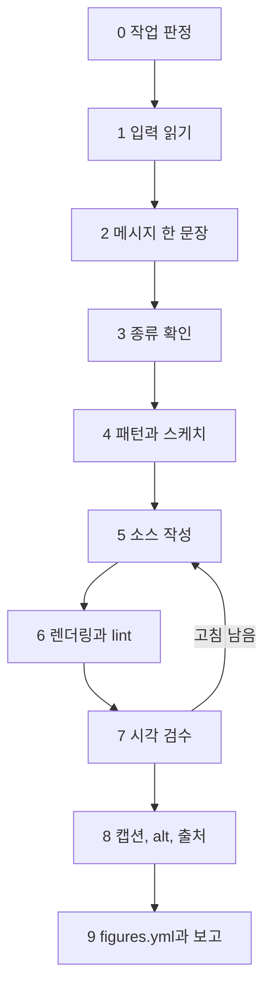

# making-figures: 그림 제작 절차

이 스킬은 설계서 그림 명세 한 행을 출간용 SVG 한 장으로 바꾸는 절차입니다. 목표는 237개 그림이 한 사람이 그린 것처럼 보이는 것이고, 그 기준은 저자가 승인한 최종 시안 5장(`docs/style-board/final/`)입니다. 세부 규칙은 모두 `references/`에 있고, 이 파일은 각 단계에서 무엇을 언제 열지만 알려 드려요.

references 파일은 필요한 단계에서만 엽니다. 처음에 8개를 전부 읽으면 맥락이 길어져 정작 명세 행의 숫자를 놓치기 쉽기 때문입니다. 디자인 규칙의 정본은 `docs/style-guide.md`이고, references는 그것을 작업 순서로 압축한 것입니다.

## 1. 언제 쓰는가, 쓰지 않는가

쓰는 경우
- 본문 그림 하나: `vol*/chNN/figures/ID.*` (설계서 5장 각 장의 "그림 명세" 표 한 행)
- 장 전체 그림: 그 장 명세 표의 모든 행, 마지막 한 장 요약 그림 포함
- 0장(`ch00/figures/`), 부 도입(`vol*/figures-part/`), 맺음말(`vol3-physical-ai/figures-epilogue/`), 앞부분(`vol*/front/figures/`), 부록(`vol*/appendix/figures/`) 그림
- 기존 그림 고치기: 숫자, 문구, 배치, 강조 수정과 다시 렌더링
- EPUB 세로 변형(`ID.v.svg`)만 만들거나 고치기
- `figures.yml` 항목, 캡션, 대체 텍스트, 출처 줄, 🔄 기준일 작성

쓰지 않는 경우

| 작업 | 맡는 곳 |
|---|---|
| 원고 본문(그림 앞뒤 문단, 해석, 비유가 틀리는 지점), 이미지 줄을 `index.md` 제자리에 넣기 | `writing-chapter` 스킬 |
| 출처 수집, `references.yml` 키 만들기, 🔄 관리표 갱신안 | researcher 에이전트 |
| 남이 만든 그림의 독립 검수 | reviewer 에이전트(`qa-checklist.md` 6장을 씀) |
| 색 토큰, 공통 부품, figkit, figlib 자체를 고치기 | 그림 작업이 아님. 필요하면 수정안을 보고합니다 |

이 스킬은 캡션과 대체 텍스트를 조립한 이미지 줄 한 줄까지 만들어 넘깁니다. 원고에 끼워 넣는 일은 writing-chapter 몫이에요(`caption-alt.md` 1.1절).

## 2. 절차 한눈에 보기



| 단계 | 산출물 | 이때 여는 reference |
|---|---|---|
| 0. 작업 판정 | 그림 하나 / 장 전체 / 고치기 / 세로 변형만 | 없음 |
| 1. 입력 읽기 | 입력 메모(명세 원문, 정본 ID와 문자열, 개념색, 시나리오 값) | `choose-type.md` 부록 B 명령 1(명세 행 뽑기) |
| 2. 메시지 한 문장 | `figures.yml`의 `message`, `accent`, `role` | `design-rules.md` 2장, 3장 |
| 3. 종류 확인 | 최종 종류, 소스 구성, `kind`, `epub_variant`, `note` | `choose-type.md` 4장(판단 흐름), 5장(세로 변형), 6장(파일 이름) |
| 4. 패턴과 스케치 | 구도 메모(캔버스, 열 x, 상자 크기, 강조 자리) | `patterns.md` 1장, 부록 A, 해당 패턴 절 |
| 5. 소스 작성 | `ID.mmd` / `ID.build.py` / `ID.py` / `ID.yml` | M `mermaid-guide.md` 2~6장, S `svg-guide.md` 3~10장, C `chart-guide.md` 2~5장, T `svg-guide.md` 9장, 공통 `design-rules.md` 4~8장, 11장 |
| 6. 렌더링과 lint | `ID.svg`, `ID.v.svg`, 경고 0 또는 사유 | `mermaid-guide.md` 1장, 9장, `svg-guide.md` 12장, `chart-guide.md` 7장, `design-rules.md` 12장 |
| 7. 시각 검수 | `_render/qa/` PNG 묶음, 판정, 장 대조판, `notes.md` 검수 기록 | `qa-checklist.md` 2~5장(3.8절 4장 추가 점검, 4장 5번 장 대조판), `design-rules.md` 2.1절, 3장, 9장 |
| 8. 캡션, alt, 출처 | `caption`, `alt`, `source`, `refresh`, 이미지 줄 | `caption-alt.md` 2~5장, 7장 |
| 9. figures.yml과 보고 | `status` 갱신, 사용자 보고 | `caption-alt.md` 6장, `qa-checklist.md` 5.3절 |

### 세련됨을 지키는 다섯 원칙

시안과 같은 손으로 보이게 하는 핵심만 추렸습니다. 근거와 수치는 `design-rules.md` 9장, 10장에 있습니다.

1. 메시지 하나, 강조 하나: accent는 메시지를 증명하는 한 덩어리(칩 포함 3군데 이하)에만 쓰고 나머지는 회색으로 확실히 낮춥니다.
2. 패턴 치수를 다시 씁니다: 표준 열(x 24, 232, 440), 상자 크기, 간격은 `patterns.md` 표 값만 써서 장이 달라도 모서리가 같은 세로선에 서게 합니다.
3. 공통 도구만 씁니다: 색은 토큰 이름으로 고르고 HEX를 손으로 적지 않습니다. 생성된 SVG는 손으로 고치지 않고 소스를 고쳐 다시 만듭니다.
4. PNG를 직접 보고 판단합니다: lint 통과는 시작일 뿐이에요. 겹침, 강조의 지각, 흑백 구분은 픽셀에서만 드러납니다.
5. 시안과 같은 손, 장 안에서 한 시스템: 넘기기 전에 같은 종류의 시안 PNG와 나란히 열고, 어긋난 기준 번호부터 고칩니다. 같은 장 그림끼리도 대조판으로 모양 언어(토큰 줄, 호, 띠, 강조)를 맞춥니다.

## 3. 단계별 절차

### 0단계: 작업 판정

요청을 보고 작업 종류와 대상 그림 ID를 먼저 정합니다. 판정이 애매하면(예: "4장 그림 손봐 줘"가 한 장인지 전부인지) 사용자에게 묻습니다.

| 작업 | 도는 단계 | 주의 |
|---|---|---|
| 그림 하나 | 1~9 전부 | 가장 기본 |
| 장 전체 | 그림마다 1~9, 한 장 요약은 맨 끝 | 같은 패턴 그림끼리 치수를 맞추고, 요약은 다른 그림이 끝난 뒤 만듭니다 |
| 고치기 | 1(바뀐 입력만), 5~9 | 생성된 SVG를 직접 고치지 않고 소스를 고칩니다. 메시지가 바뀌면 2단계부터 |
| 세로 변형만 | 3(5장 판단), 5~7, 9 | 본문 판과 같은 소스의 `LAYOUT['v']`나 `--width 360`으로. 숫자, 메시지, 강조는 본문 판과 같게 |
| 번호 이동 | `choose-type.md` 6.1절 점검표 10줄, 6, 9 | 설계서 그림 명세가 먼저 바뀐 뒤(저자 승인)에만. 뒤 번호부터 옮기고, `check_figures.py` F16이 소스 안 옛 ID를 잡습니다 |
| 캡션, alt만 바꾸기 | 8, 9 | `caption-alt.md` 6.4절. `figures.yml`을 먼저 고치고 같은 회차에 원고 그림 줄과 SVG desc를 같은 글로(F11) |

### 1단계: 입력 읽기

그림에서 가장 비싼 실수는 선이 아니라 입력에서 생깁니다. 아래를 읽고 ID와 위치만 메모하며, 값은 원문에서 다시 봅니다.

| 입력 | 위치 |
|---|---|
| 그림 명세 행 | 해당 권 설계서 5장의 그 장 "그림 명세" 표(ID, 종류, 내용). 🔄 표시도 여기서 확인 |
| 숫자 정본 | 해당 권 설계서 7장. 명세에 정본 ID(N4-2 등)가 있으면 그 행 |
| 개념 색상 고정표 | 1권 6.2절, 2권 6.2절, 3권 6.2절(앞 권 확장). HEX는 `assets/tokens/colors.json` |
| 시나리오 정본 | `docs/scenario-hanbit.yml`. 아직 없으면 2권, 3권 설계서 8장 |
| 🔄 관리표 | 1권 9장, 2권과 3권 10장(🔄 그림만) |
| 원고 문맥 | `vol*/chNN/index.md`의 그 그림 앞뒤 절(있으면). 그림이 무엇을 증명해야 하는지 확인 |
| 기존 기록 | `docs/figures.yml`의 그 ID 항목(파일이 생기면). 없으면 새 항목을 만듭니다 |

명세에 없는 숫자, 사실, 비유가 필요해 보이면 그리지 말고 정본 추가나 명세 수정안을 먼저 제안해요.

### 2단계: 메시지 한 문장

**열 것**: `design-rules.md` 2장(메시지 서식과 강조 범위), 3장(요소 수 상한).

소스를 열기 전에 40자 이하 습니다체 한 문장과 강조 대상 하나를 정해 `figures.yml`의 `message`, `accent`에 적습니다. 문장이 없으면 무엇을 강조하고 무엇을 덜어 낼지 정할 수 없기 때문이에요. 메시지가 둘이면 그림을 나누거나 하나를 캡션으로 보냅니다. 명세 내용과 메시지가 어긋나면 설계서 수정안을 먼저 올립니다.

### 3단계: 종류 확인

**열 것**: `choose-type.md` 4장 판단 흐름. 결과에 따라 3.1절(척추 그림), 3.2절(한 장 요약), 3.3, 3.4절(D3 재작도 신호)을 봅니다. 이어서 5장(세로 변형과 auto/manual), 6장(파일 이름과 위치)을 봐요.

기본값은 명세의 종류입니다. D3 기준에 드는 그림만 수정안 없이 S로 다시 그리고, `kind`는 명세 값 그대로 두며 사유를 `note`에 적어요. 그 밖의 종류 변경과 그림 나누기는 설계서 수정안이 먼저입니다.

### 4단계: 패턴 고르기와 스케치

**열 것**: `patterns.md` 1장(쓰는 법과 공통 틀), 부록 A(그림 ID별 패턴), 그 패턴 절(P1~P16, 기타). 표지 안쪽 세트(1-9-6, 2-0-2, 3-0-2)는 8장, 한 장 요약은 P16을 봅니다.

부록 A에서 ID를 찾아 패턴을 확인하고, 와이어프레임과 격자표를 따라 구도 메모를 씁니다. 메모에는 캔버스(640 × 높이 단계), 열 x 값, 상자 크기, 강조 자리, 지시선 방향, 세로 변형 재배치를 적어요. 표에 없는 치수를 새로 만들지 않습니다. 패턴이 맞지 않아 보이면 바꾸기 전에 사유를 `note`에 남깁니다.

### 5단계: 소스 작성

도구별로 여는 문서가 다릅니다.

| 종류 | 열 것 | 시작점 | 시작점이 금지된 경우의 대체 견본 |
|---|---|---|---|
| M | `mermaid-guide.md` 2장(머리 주석), 4장(클래스), 5장(노드 문구), 6장(LR과 TB), 8장(배치 보정) | `docs/style-board/final/1-4-3.mmd` | `mermaid-guide.md` 2장 본보기 |
| S | `svg-guide.md` 3장(골격), 4~6장(캔버스, 격자, 요소), 7, 8장(부품, 로봇, 데모), 10장(세로 변형) | `docs/style-board/final/1-4-4.build.py`, 요약은 `1-4-8.build.py` | `docs/style-board/final/1-4-8.build.py`(요약이면 `1-4-4.build.py`), `svg-guide.md` 3장 최소 예제 |
| C | `chart-guide.md` 2장(골격), 3장(함수 지도), 4장(종류별 서식), 5장(데이터 규칙) | `docs/style-board/final/1-5-5.py`, `chart-guide.md` 8장 예제 | `chart-guide.md` 8장 예제 |
| T | `svg-guide.md` 9장(table.py 명세) | `docs/style-board/final/2-4-2.yml` | `assets/svg-parts/_build/table-samples/`의 `sheet-*.yml` |
| 공통 | `design-rules.md` 4~8장(라벨, 칩, 색, 글자, 레이아웃, 쓰지 않는 표현), 11장(그림 안 글자) | | |

평가 실행처럼 시작점 파일을 열지 말라는 지시가 있으면 마지막 칸의 대체 견본을 씁니다. 대체 견본에서는 골격(머리 docstring, `LAYOUT`, 빌드와 저장 순서)만 빌리고, 치수와 강조 방식은 `patterns.md`의 해당 패턴 표에서 가져와요. 견본이 다른 패턴이라 그 치수를 옮기면 구도가 어긋나기 때문입니다. 7단계 시안 대조도 같은 종류 시안을 열 수 없으면 `qa-checklist.md` 5.3절대로 `design-rules.md` 9장 표의 관찰값으로 대신합니다.

- 머리에 그림 ID, 명세 원문, 메시지, 정본 ID와 문자열, 설계 판단을 적습니다(M은 `%%` 주석, S와 C는 docstring).
- 정본 숫자는 설계서 7장의 문자열 그대로 상수에 둡니다. 서식 함수로 다시 만들지 않습니다.
- 노드, 단계, 입력 이름은 설계서 명세 행, 원고, 정본 행, 승인 시안 예(references에 실린 것)의 용어를 그대로 씁니다. 상자를 줄이려고 이름을 바꾸거나 연산 문구를 빼지 않아요. 바꿔야 하면 `note`에 사유를 적습니다. 이름은 alt와 캡션으로 그대로 옮겨 갑니다.
- 명세에 없는 하위 구성(예: "센서 입력"이 무슨 센서인지)을 라벨에 붙이지 않습니다. 부연 한 줄을 더하면 같은 열 상자 크기도 어긋나니 부연은 캡션으로 보냅니다(`design-rules.md` 11장).
- Mermaid는 상자 폭을 문구 길이가 정합니다. 패턴 표의 폭(P1 주 열 240 등)에 맞게 문구 층을 고르고, 렌더링 뒤 실측 폭을 패턴 값과 대조합니다(`mermaid-guide.md` 5장 "패턴 기준 폭과 문구").
- 세로 변형은 같은 소스 하나가 함께 만듭니다(S와 C는 `LAYOUT`, T는 `--variant v`). 폭은 360이고, 400은 정본 숫자 묶음이 328에 안 들어갈 때만입니다(`svg-guide.md` 10장).
- figkit은 대체 텍스트(`desc`) 없이 저장되지 않고, figkit lint는 도구와 상관없이 `desc`가 없으면 오류를 냅니다. 그래서 이 단계에서 alt 초안을 `desc`(M은 `accDescr`)에 넣어 저장하고, 확정은 8단계에서 합니다(`caption-alt.md` 6.1절).

### 6단계: 렌더링과 lint

**열 것**: M은 `mermaid-guide.md` 1장, 9장(경고 대처표)입니다. S와 T는 `svg-guide.md` 12장(오류표), C는 `chart-guide.md` 7장. 공통으로 `design-rules.md` 12장(렌더링 전 빠른 점검).

```bash
bash scripts/render_mermaid.sh vol1-llm/ch04                                 # M 전부(--variant: 세로 변형 auto, --check: 렌더링 안 된 변경만 보고)
.venv/bin/python scripts/build_charts.py vol1-llm/ch04 --kind all            # S(.build.py), C(.py), T(.yml) 전부와 lint(--check: 오래된 SVG만 보고)
.venv/bin/python assets/svg-parts/_build/figkit.py lint vol1-llm/ch04/figures/*.svg      # 도구와 상관없이 출력 SVG lint
```

그림 하나만 다시 만들 때는 같은 명령에 파일을 줍니다(`render_mermaid.sh X.mmd`, `build_charts.py X.build.py`). 도구를 직접 부르는 개별 명령(`assets/mermaid/_build/render.sh X.mmd X.svg`, `.venv/bin/python X.build.py 폴더`, `.venv/bin/python -W error::UserWarning X.py 폴더`, `table.py X.yml -o X.svg`)은 스크립트를 못 쓸 때의 예비 수단이고 `qa-checklist.md` 2.1절에 있어요. `build_charts.py --strict`는 UserWarning을 오류로 봅니다.

경고가 있어도 종료 코드가 0인 도구가 있으니 출력의 "경고" 줄을 꼭 읽어요. M은 두 번 고쳐도 배치 경고가 남으면 `choose-type.md` 3.4절대로 S 재작도를 판단합니다. 요소 수 경고는 종류 문제가 아니라 내용 문제라서 덜어 내기가 먼저입니다.

### 7단계: 시각 검수

**열 것**: `qa-checklist.md` 2장(미리보기 묶음 명령과 PNG 이름), 3장(Q1~Q27), 4장(세련됨 최종 판정), 5장(등급과 기록). 판정 기준은 `design-rules.md` 9장 12가지입니다.

1. `.venv/bin/python scripts/figure_qa.py vol1-llm/ch04 --sheet`(`qa-checklist.md` 2.2절)로 PNG를 만듭니다. 컬러, 흑백, 색약 2종, 휴대폰 폭, 다크 카드, 세로 변형, 검수 시트이고 자리는 `figures/_render/qa/`예요. 출력의 FQ-CHIP(칩 글자 넘침), FQ-W328M(메시지 글자가 폭 328에서 기준 미만), FQ-V(14 글자 목록) 줄을 검수 기록에 옮깁니다.
2. PNG를 Read 도구로 한 장씩 엽니다. 만들기만 하고 열지 않은 검수는 검수가 아닙니다.
3. Q1~Q27에 예, 아니요를 붙입니다. 4장에서 자가 검수가 놓친 것을 붙인 `qa-checklist.md` 3.8절 표(칩 글자 폭, 휴대폰 폭 수치 판정, 칩과 대상 거리, 패턴 오독, 무아레와 빈 띠, 로그 눈금)도 줄마다 봅니다. Q12(메시지 가리기)는 `message`를 보기 전에 그림이 말하는 바를 먼저 적고 대조하고, 모양이 뜻을 나르는 그림은 패턴마다 "이 모양이 말하는 것"도 적어요(`design-rules.md` 2.1절). w328 판정은 "읽힘"이 아니라 CSS px 수치로 적습니다. Q8은 `patterns.md` 9.2절 명령으로 SVG의 열별 상자 크기를 읽어 패턴 표와 맞춥니다. 검수 기록의 치수는 이 출력에서 옮겨 적어요(`qa-checklist.md` 5.3절).
4. 같은 종류의 시안 PNG(M 1-4-3, S 1-4-4, C 1-5-5, T 2-4-2, 요약 1-4-8)를 연달아 열어 12가지 기준을 대조합니다. 같은 종류 시안을 열 수 없어 다른 시안과 대조했다면 9장 표에서 같은 종류 그림의 관찰값을 줄마다 확인합니다(`qa-checklist.md` 5.3절).
5. 장 그림이 둘 이상 끝났으면 장 대조판(같은 장 컬러 PNG를 한 장에 붙인 것, `qa-checklist.md` 4장 5번)을 열어 머리줄, 토큰 줄, 선 굵기, 강조 방식, 같은 개념의 모양이 한 시스템인지 봅니다. 4장 1-4-5는 1-4-1의 호 언어를 이어받아 그물과 오독이 함께 풀렸어요.
6. "고침"이 하나라도 있으면 5단계로 돌아가 소스를 고치고, 6단계부터 다시 돌며 Q1부터 다시 봅니다.

3권 로봇 닮음(Q24)과 기준 밖 위화감은 에이전트가 통과로 닫지 않고 저자 확인으로 올립니다.

### 8단계: 캡션, 대체 텍스트, 출처

**열 것**: `caption-alt.md` 2장(캡션), 3장(대체 텍스트, SVG `<desc>`는 3.4절), 4장(출처 결정표), 5장(🔄 기준일), 7장(점검 명령).

시각 검수를 마친 뒤 `figures.yml`에서 `caption`, `alt`, `source`, `refresh`를 확정합니다. 캡션과 alt를 고치는 순서의 기준은 `figures.yml`이고, 원고 그림 줄과 SVG desc는 같은 회차에 같은 글로 바꿉니다(`caption-alt.md` 6.4절). 한쪽만 바꾸면 `check_figures.py` F11이 막아요. `source.kind: own`이면 캡션과 alt에 회사명, 모델명을 쓰지 않고 "한 대표 사례의 공개값"처럼 씁니다(`caption-alt.md` 2.2절). 차트 alt의 핵심 숫자는 2~4개로 고릅니다(3.2절). 확정한 alt는 5단계 초안 자리(`desc`나 `accDescr`)에 옮겨 다시 빌드합니다. SVG `<desc>`와 `alt`가 글자 단위로 같은지는 `caption-alt.md` 7장 명령으로 확인해요. 순서는 늘 기록부가 먼저입니다. 출처 키가 `references.yml`에 없으면 키를 지어 넣지 않고 researcher 몫으로 보고합니다. 끝으로 style-guide 8.6절 조립 규칙대로 이미지 줄 한 줄을 만들어 writing-chapter에 넘깁니다.

### 9단계: figures.yml 갱신과 보고

**열 것**: `caption-alt.md` 6장(항목 채우는 순서, 필드별 서식), `qa-checklist.md` 5.3절(검수 기록 서식).

- `status`는 spec → source → rendered → reviewed 순서로 올립니다. `approved`는 저자만 적어요.
- 규칙 예외(높이 초과, 선택 세로 변형, D3 재작도, lint 경고 사유)는 `note`에 한 줄로 남깁니다.
- 장 `notes.md`에 그림마다 검수 기록 블록을 붙입니다.
- 사용자 보고에는 만든 파일, 판정(통과, 고침 남은 수, 저자 확인), 설계서와 다른 점과 제안을 적습니다.

`docs/figures.yml`은 세 권 그림이 한 파일에 있는 공유 기록부라 여러 에이전트가 동시에 고칩니다. Edit 도구로 맡은 ID 항목의 바뀐 줄만 고치고, 파일 전체를 다시 쓰지 않습니다(Write, `yaml.dump`, 스크립트 전체 치환 금지). 4장에서 한 에이전트가 파이썬으로 파일 전체를 다시 써서 남의 갱신을 덮을 뻔했어요. 세부는 `caption-alt.md` 6.3절입니다.

## 4. 출력 파일

| 파일 | 내용 | 만드는 단계 | 저장소 |
|---|---|---|---|
| `vol*/chNN/figures/ID.mmd` | M 소스 | 5 | 예 |
| `vol*/chNN/figures/ID.build.py` | S 소스(세로 변형 함께) | 5 | 예 |
| `vol*/chNN/figures/ID.py` | C 소스(세로 변형 함께) | 5 | 예 |
| `vol*/chNN/figures/ID.yml` | T 명세 | 5 | 예 |
| `vol*/chNN/figures/ID.v.mmd`, `ID.v.build.py` | M 세로 변형 소스(manual일 때만) | 5 | 예 |
| `vol*/chNN/figures/ID.svg`, `ID.v.svg` | 출력(편집용, 글자는 `<text>`) | 6 | 예 |
| `vol*/chNN/figures/_render/qa/ID.*.png` | 미리보기 묶음 | 7 | 아니요(`.gitignore`) |
| `docs/figures.yml`의 ID 항목 | 메시지, 캡션, alt, 출처, 상태 | 2, 3, 8, 9 | 예 |
| `vol*/chNN/notes.md`의 검수 기록 | 시각 검수 판정과 근거 | 7, 9 | 예(빌드 제외) |

부 도입 그림은 `vol*/figures-part/`, 0장은 `ch00/figures/`, 맺음말은 `vol3-physical-ai/figures-epilogue/`, 앞부분은 `vol*/front/figures/`, 부록은 `vol*/appendix/figures/`에 같은 규칙으로 둡니다(ID 꼴은 `choose-type.md` 6장). 미리보기 PNG를 `figures/` 바로 아래에 만들면 커밋될 수 있으니 반드시 `_render/qa/`에 둡니다.

## 5. 하지 않는 일

| 하지 않는 일 | 대신 할 일 | 이유 |
|---|---|---|
| 정본 밖 숫자, 반올림한 숫자 쓰기 | 정본 문자열 그대로. 새 값은 정본 추가 제안 | 세 권의 숫자가 서로 맞물려 있습니다(CLAUDE.md 8장) |
| 외부 그림 재사용, 논문 그림 복사 | 새로 그리고 "참고하여 재구성"으로 표기 | CLAUDE.md 10장 |
| 실제 제품 화면 캡처, 로고, 브랜드 색 흉내 | 중립 상자와 장 아이콘 세트 | 특정 제품 광고처럼 읽힙니다 |
| 실제 로봇을 닮게 그리기, 로봇 직접 그리기 | `assets/svg-parts/robots.svg`의 `rb-` 부품만, 닮음은 저자 확인 | style-guide 9.4절 |
| 원고 본문 쓰기, `index.md`에 직접 끼워 넣기 | 이미지 줄을 만들어 writing-chapter에 넘김 | 두 스킬의 분담(`caption-alt.md` 1.1절) |
| 명세와 다른 종류로 몰래 바꾸기, 그림 나누기 | D3 기준이면 `note`에 사유, 아니면 설계서 수정안 | `check_figures.py`가 설계서 명세와 대조합니다(F09, F20) |
| HEX 손입력, 새 색, 새 무늬 만들기 | 토큰 이름. 필요하면 `colors.json` 추가 제안 | 흑백 표지와 팔레트 검사가 깨집니다 |
| 생성된 SVG 손편집, PNG 손보기 | 소스를 고쳐 다시 실행 | 다음 실행에서 되돌아가고 정본 대조가 갈라집니다 |
| 글자 크기, 간격을 줄여 넘침 맞추기 | 덜어 내기, 문구 줄이기, 높이 단계 올리기 | 가장 흔한 실패예요(`design-rules.md` 3장) |
| `approved` 적기, 출처 확정 | 사람이 확인한 뒤에만 | CLAUDE.md 8장 |
| `docs/figures.yml` 전체 다시 쓰기(Write, `yaml.dump`) | Edit로 맡은 항목의 줄만 | 동시 작업 중인 남의 갱신이 사라집니다(`caption-alt.md` 6.3절) |
| Mermaid 메시지 숫자를 `*강조*`(밑줄)로 | `msg` 상자 안 `**숫자**`(600), 칩이 필요하면 S 재작도 | 밑줄이 링크처럼 보입니다(`mermaid-guide.md` 5장, 4장 R1-G04) |
| 그림 파일 이름만 바꿔 번호 이동 | `choose-type.md` 6.1절 점검표 전부 | 소스 안 ID, 기록부, 원고, 설계서가 갈라집니다(F16, F10, F01) |

## 6. 막혔을 때

사실, 수치, 디자인 판단이 모호하면 추측으로 채우지 말고 묻습니다. 무엇이 모호한지, 어디서 확인하려 했는지(설계서 절, 정본 ID, references 장), 선택지가 무엇인지를 함께 적어 주세요.

자주 막히는 지점
- 요소 수가 상한을 넘음: 덜어 내기가 먼저고, 명세가 이미 넘으면 나누기 수정안을 냅니다(`design-rules.md` 3장)
- Mermaid 경고가 두 번 고쳐도 남음: `choose-type.md` 3.4절대로 S 재작도, 사유는 경고 문구 그대로
- 패턴에 맞는 치수가 없음: "기타" 공통 틀로 그리고 새 치수는 제안으로 보고합니다(`patterns.md` 7장)
- 정본에 없는 값이 명세에 있음: 그리지 않고 정본 추가안을 냅니다
- figkit 오류가 계속 남: 오류는 "배치나 문구를 다시 정하라"는 신호입니다(`svg-guide.md` 12장 오류표)
- Mermaid에서 숫자 칩이나 칩 모양 강조가 필요함: 뒤 처리가 `*강조*`를 밑줄로만 그려 칩을 못 그립니다. `msg` 상자 + 굵기 600으로 두거나, 칩이 꼭 필요하면 `choose-type.md` 3.3절 "숫자 칩 필요"로 S 재작도를 판단합니다. 공통 도구(`postprocess.mjs`)는 고치지 않고 제안으로 올려요(`mermaid-guide.md` 5장)
- 원고 회차가 캡션을 바꾸려는데 F11에 막힘: `caption-alt.md` 6.4절대로 `figures.yml`을 먼저 고치고 같은 회차에 원고 줄을 맞춥니다
