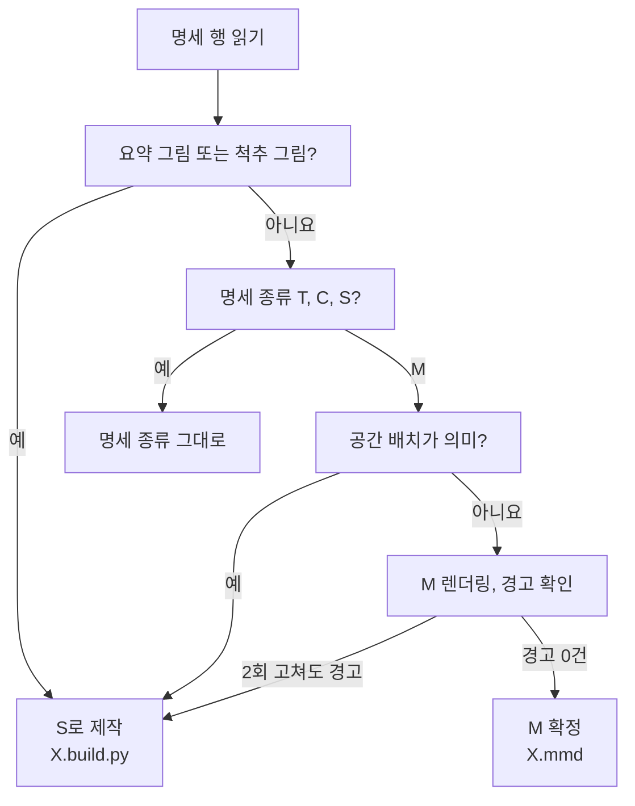

# 그림 종류 고르기: M, S, C, T와 D3 재작도 기준

그림 하나를 만들기 전에 "어떤 도구로, 어떤 소스 파일로 만들지"를 정하는 문서입니다. 기본값은 설계서 그림 명세의 종류이고, 이 문서는 그 값을 그대로 쓸 때와 D3 결정에 따라 SVG로 다시 그릴 때를 가릅니다.
이 문서의 산출물은 세 가지예요: 최종 종류, 소스 파일 구성, `figures.yml`의 `kind`, `epub_variant`, `note` 값입니다.

여기서는 "어떤 종류로 만들지"까지만 다룹니다. 모양 규칙은 `design-rules.md`, 레이아웃 꼴은 `patterns.md`를 봅니다. 도구별 제작법은 `mermaid-guide.md`, `svg-guide.md`, `chart-guide.md`에 있어요.

## 목차

1. 원칙: 설계서 종류가 기본값
2. 네 종류의 정의와 잘 맞는 내용
3. D3: SVG로 다시 그리는 그림
4. 판단 흐름과 결정표
5. EPUB 세로 변형: 필요 여부와 auto/manual
6. 파일 이름과 위치
7. 경계 사례
8. 자주 하는 실수

부록 A. 설계서 그림 집계 / 부록 B. 재현 명령

---

## 1. 원칙: 설계서 종류가 기본값

- 그림 명세 표(각 권 설계서, 장마다 "그림 명세")의 `종류` 열이 출발점입니다. 그 값을 `figures.yml`의 `kind`에 그대로 적습니다(style-guide 8.6절).
- 종류를 바꾸고 싶으면 원고나 그림을 먼저 바꾸지 않습니다. 설계서 수정안을 사용자에게 올리고 승인 뒤 반영합니다(CLAUDE.md 2장).
- 예외는 하나, D3입니다. D3는 이미 승인된 결정이라 3장 기준에 드는 그림은 수정안 없이 SVG로 다시 그립니다. 다만 그 사실을 `note`에 남깁니다.
- 그림 수를 늘리거나(나누기) 줄이는 것도 종류 변경과 같게 다룹니다. 설계서 그림 수는 `check_figures.py`가 대조하는 값이기 때문입니다(tasks.md 4.6절).

왜 이렇게 엄격할까요? 종류가 바뀌면 소스 파일 확장자, 렌더링 경로, 세로 변형 방식, 검사 항목이 함께 바뀝니다. 그림 237개를 한 사람이 그린 것처럼 맞추려면 이 선택이 그림마다 흔들리면 안 돼요.

## 2. 네 종류의 정의와 잘 맞는 내용

| 종류 | 도구와 소스 | 잘 맞는 내용 | 맞지 않는 내용 | 대표 ID |
|---|---|---|---|---|
| M | Mermaid `.mmd` + 공통 설정, 뒤 처리(style-guide 9.8절) | 노드 7개 이하의 단계 흐름, 루프, 분기 흐름도. 위치에는 뜻이 없고 연결 순서만 뜻이 있는 그림 | 위치나 크기가 값인 그림, 숫자 칩과 지시선이 메시지인 그림, 여러 칸을 나란히 놓는 그림 | 1-4-3, 1-5-4, 2-5-3 |
| S | `.build.py`(공통 부품 `concepts.py`, `figkit.py`)로 SVG 생성 | 비유 장면, 구조도, 비교도, 좌표와 층, 띠 폭 = 가중치, 한 장 요약 | 축 눈금으로 값을 재야 하는 그래프(C), 칸을 고르게 읽는 계산표(T) | 1-4-4, 1-4-8, 3-2-1 |
| C | matplotlib `.py` + `book.mplstyle`, `figlib`(style-guide 9.7절) | 축이 값을 재는 그림: 곡선, 막대, 로그 축, 산점도, 정본 숫자의 추이 | 값이 아닌 개념의 배치, 계열 4개 이상(본문 폭 상한 3) | 1-5-5, 2-6-6, 3-11-4 |
| T | 명세 `.yml` + `table.py`(style-guide 9.5절) | 정본 손계산을 칸으로 보이고 한 칸이 메시지를 증명하는 표 | 칸을 고르게 읽는 비교표와 체크리스트(본문 마크다운 표로) | 2-4-2, 3-5-3 |

두 가지를 함께 기억해 두세요.
- 본문 마크다운 표는 그림이 아니고 그림 수에도 들어가지 않습니다(1권 설계서 그림 종류 약어). T가 아닌 표를 그림으로 만들려면 설계서 수정안이 먼저입니다(style-guide 9.5절).
- 요소 수 상한(style-guide 6.3절)은 종류마다 다릅니다. 상한을 넘었다는 이유만으로 종류를 바꾸지 않습니다. 먼저 덜어 내고, 그래도 넘으면 나누기 수정안을 냅니다.

## 3. D3: SVG로 다시 그리는 그림

D3(tasks.md 1.3절, 2026-10-13 확정)의 원문은 이렇습니다. "소스는 Mermaid로 유지하고 공통 테마와 클래스로 꾸며 렌더링. 권별 척추 그림(성숙도 사다리, 계층 지도, 3부작 지도, 연결 그림)과 디자인이 중요한 요약 그림은 SVG로 다시 그림."
이 장은 그 문장을 네 가지 기준으로 풀어 씁니다. 3.1과 3.2는 무조건, 3.3과 3.4는 판단이 필요한 경우예요.

### 3.1 권별 척추 그림 (무조건 S)

설계서를 검색해 찾은 실제 목록입니다(부록 B 명령 2). 명세 종류가 M이어도 S로 만듭니다.

| ID | 명세 종류 | 내용 | 근거 |
|---|---|---|---|
| 1-9-6 | M | LLM → VLM → VLA 계보 다리. 1권 표지 안쪽 그림 | 명세 원문에 "D3에 따라 SVG로 다시 그림" |
| 2-0-2 | M | 에이전트 성숙도 사다리 L0~L5 정식판. 2권 표지 안쪽 | D3 "성숙도 사다리", 2권 설계서 B3 "척추 그림" |
| 3-0-2 | M | Physical AI 계층 지도 P0~P4 정식판. 3권 표지 안쪽 | D3 "계층 지도", 3권 설계서 B3 "척추 그림" |
| 3-1-5 | M | 계층 지도 P0~P4와 3권 장 번호 | D3 척추 그림(2026-10-15 저자 결정). 명세 종류 M은 그대로 두고, 명세 문구에 "D3에 따라 SVG로 다시 그림"이 붙음. 3-0-2와 같은 밑그림을 씀 |
| 3-12-6 | S | 3부작 연결 그림 겸 한 장 요약 | D3 "연결 그림". 명세가 이미 S |
| 1-12-7, 2-12-6 | S | 한 장 요약. 마지막 화살표가 다음 권 표지로 이어짐 | 다음 권 표지 그림 세트와 이어지는 연결 그림 |
| 1-F-2, 2-F-2, 3-F-2 | 없음 | 권별 앞부분의 3부작 지도 | D3 "3부작 지도". 앞부분 그림은 설계서 그림 수 밖(6.1절 아래 장 밖 그림 표), ID는 2026-10-17 저자 결정 |
| 3-E-1 | 없음 | 맺음말 시리즈 지도(계층 지도 옆에 세 권 표시) | D3 "계층 지도, 3부작 지도". 2026-10-17 저자 결정으로 S |
| (ID 미정) | 없음 | 3권 앞부분 "이 책을 읽는 법"의 일반화 사다리 G0~G5 | 설계서 9.1절 표에 그림 행이 없어 ID 없음(저자 확인) |

- 표지 안쪽 세트(1-9-6, 2-0-2, 3-0-2)는 같은 디자인이어야 한다고 명세가 적고 있습니다. 세 그림을 같은 `.build.py` 틀에서 만들어 칸 높이, 글자, 색 계조를 공유하세요.
- 사다리와 지도는 아래에서 위로 올라가는 위치 자체가 뜻입니다. Mermaid 자동 배치는 단계 높이를 보장하지 못합니다.

### 3.2 한 장 요약 그림 (무조건 S)

장의 마지막 그림은 모두 S이고, 1-4-8 표 틀 하나를 표준으로 씁니다(style-guide 6.9절). 설계서 명세 표의 요약 35개(1권 11, 2권 12, 3권 12)도 모두 S입니다.
요약은 레이아웃을 새로 고안하지 않으므로 종류 판단이 필요 없어요. 바로 1-4-8의 `.build.py`를 복사해 시작합니다.

### 3.3 공간 배치가 의미인 그림

다음 중 하나라도 맞으면 Mermaid로 그리지 않습니다. 명세가 M인데 여기에 걸리면 3.5절대로 처리합니다.

| 신호 | 왜 Mermaid가 안 되나 | 예 |
|---|---|---|
| 위아래, 좌우 위치가 순위, 층, 시간 같은 값을 뜻함 | ELK는 연결 순서로 줄(rank)을 정하지, 값으로 정하지 않음 | 2-0-2 사다리, 3-0-2 계층 |
| 크기나 굵기가 값을 뜻함 | 노드 크기와 선 굵기를 데이터로 정할 수 없음 | 1-4-4 띠 폭 = 가중치(style-guide 6.12절) |
| 같은 밑그림 여러 칸을 나란히 비교(작은 그림 묶음) | 칸마다 같은 격자에 맞출 수 없음 | 2-6-3 패턴 5종 다섯 칸 |
| 숫자 칩, 주석 지시선, 단계 상자 머리 행, 물결 테두리, 줄무늬 면이 필요 | Mermaid로 그리지 않는다고 정함(style-guide 9.8절 금지 사항) | 지시선이 메시지를 짚는 그림 |
| 2×2 매트릭스, 벤 다이어그램, 좌표계, 로봇 실루엣 | 노드와 연결선의 꼴이 아님 | 2-12-1, 2-11-5, 3-2-2 |

### 3.4 Mermaid 자동 배치가 메시지를 흐리는 그림

명세대로 M으로 렌더링한 뒤, 아래 신호가 남으면 SVG로 다시 그릴지 판단합니다. 대부분은 렌더링 스크립트가 경고로 알려 줍니다(`assets/mermaid/_build/postprocess.mjs`).

| 신호 | 측정 방법 | 기준 | 근거 |
|---|---|---|---|
| 연결선 꺾임 | 경고 "꺾임 n회(2회 초과)" | 3회 이상 | style-guide 5.13, 5.14절 |
| 연결선 교차, 상자 관통 | 폭 640 PNG를 눈으로 | 1건 이상 | 5.13절 |
| 높이 초과 | 경고 "필요 높이 ... 높이 단계 상한을 넘음" | 본문 폭 640 초과, 세로 변형 720 초과 | 5.1, 5.11절 |
| 내용 폭 초과 | 경고 "내용 폭 ...px가 ... 넘음" | 본문 폭 592, 세로 변형 328 초과 | 5.12절 |
| 짧은 곧은 선 | 경고 "곧은 선 ...px(16 미만)" | 16 미만 | 5.7절 |
| 라벨 겹침 | 경고 "자리가 좁음", "연결선과 겹침" | 1건 이상 | 5.12절 |
| 세로 360 글자 | 360 렌더링을 표시 폭 328로 봄 | 주석 14가 11 CSS px 미만이 되는 축소 | 5.11절 |
| 시선 순서 | 메시지 상자(`msg`, `accent`)의 위치 | 읽는 순서(위→아래, 왼→오)의 끝이 아닌 곳에 놓임 | 6.1, 6.2절(강조는 결과 자리) |
| flowchart가 아닌 도표 | 경고 "flowchart가 아님" | 시퀀스 도표 등. 뒤 처리가 바탕과 머리줄만 고침 | 9.8절 |

판단 절차(제안: 고치기 횟수 2회는 이 문서가 새로 정한 값입니다)
1. 먼저 Mermaid 안에서 고칩니다. 문구 줄이기, `LR`과 `TB` 바꾸기, `%% row:`와 `%% column:` 정렬 힌트, `subgraph` 묶기 순서예요.
2. 두 번 고쳐도 위 신호가 남으면 SVG로 다시 그립니다. 사유를 `note`에 경고 문구 그대로 적습니다.
3. "요소 수 초과" 경고는 SVG로 옮겨도 사라지지 않습니다. 이것은 종류 문제가 아니라 내용 문제이므로 6.3절대로 덜어 내거나 나누기 수정안을 냅니다.

### 3.5 다시 그릴 때 소스 구성과 기록

하나의 출력 파일에는 소스 파일이 하나만 있어야 합니다. 같은 정본 숫자가 두 소스에 있으면 한쪽만 고쳐지는 일이 생겨요.

| 경우 | 남기는 소스 | 지우는 것 | 선례 |
|---|---|---|---|
| 본문 그림은 M으로 충분, 세로 변형만 Mermaid 경고 | `X.mmd`(본문), `X.v.build.py`(세로 변형) | 없음 | 1-4-3 |
| 본문 그림부터 SVG로 다시 그림(3.1, 3.3, 3.4) | `X.build.py` 하나가 `X.svg`와 `X.v.svg`를 함께 만듦 | 시험용 `X.mmd`는 저장소에 남기지 않음(제안) | 1-4-4, 1-4-8 |
| 명세가 처음부터 S | `X.build.py` | 없음 | 1-4-4 |

`figures.yml` 기록(style-guide 8.6절 필드만 씀)
- `kind`: 설계서 명세 값을 그대로 둡니다. 1-9-6이면 M입니다. `check_figures.py`가 설계서와 대조하기 때문이에요.
- `source_file`: 실제 소스(`X.build.py`)를 적습니다. 확장자만 봐도 재작도한 그림임이 드러납니다.
- `note`: "D3 재작도(명세 M). 사유: 척추 그림" 또는 "D3 재작도. 사유: 360 내용 폭 458 초과"처럼 3장 기준과 측정값을 적습니다.
- 1-4-8처럼 설계서 명세를 S로 고치는 편이 낫다고 보면, 그것은 설계서 수정안으로 따로 올립니다(1장).

## 4. 판단 흐름과 결정표

번호 단계로 판단합니다. 앞 단계에서 정해지면 뒤 단계는 보지 않아요.

1. 장의 마지막 그림인가? → S, 1-4-8 표 틀(3.2절).
2. 3.1절 척추 그림 목록에 있는가? → S, 표지 세트는 같은 틀(3.1절).
3. 명세가 T인가? → T, `table.py`. 6×4(펼침 폭 8×6)를 넘으면 덜어 내기, 그래도 넘으면 수정안.
4. 명세가 C인가? → C, `figlib`. 축이 값을 재지 않는 그림이면 수정안(7장 사례 6).
5. 명세가 S인가? → S.
6. 명세가 M인데 3.3절 신호가 있는가? → S로 재작도, `note` 기록.
7. 명세 M으로 렌더링 → 3.4절 신호가 고치기 2회 뒤에도 남는가? → S로 재작도. 아니면 M 확정.
8. 확정한 종류로 5장의 세로 변형 판단으로 넘어갑니다.



결정표(같은 내용을 한눈에)

| 명세 | 요약/척추 | 공간 의미 | M 경고(2회 고친 뒤) | 최종 | 소스 | `note` |
|---|---|---|---|---|---|---|
| 아무것 | 예 | 상관없음 | 상관없음 | S | `X.build.py` | 명세가 M이면 "D3 재작도" |
| M | 아니요 | 예 | 상관없음 | S | `X.build.py` | "D3 재작도. 사유: (3.3절 신호)" |
| M | 아니요 | 아니요 | 남음 | S | `X.build.py` | "D3 재작도. 사유: (경고 문구)" |
| M | 아니요 | 아니요 | 없음 | M | `X.mmd` | 없음 |
| S, C, T | 아니요 | 상관없음 | 해당 없음 | 명세 그대로 | 2장 표 | 없음 |

## 5. EPUB 세로 변형: 필요 여부와 auto/manual

종류를 정한 뒤 세로 변형(폭 360. 400은 정본 숫자 묶음이 328에 안 들어갈 때만, `svg-guide.md` 10장) 사본이 필요한지 봅니다. 규칙의 원문은 style-guide 5.11절이에요.

필요 여부
1. 펼침 폭 800 그림인가? → 반드시 만듭니다.
2. M 흐름도에서 가로 한 줄 노드가 4개 이상인가? → 반드시 만듭니다(6.3절).
3. 본문 폭 그림을 표시 폭 328로 렌더링했을 때 메시지에 필요한 라벨이 안 읽히는가? → 만들어도 됩니다. 사유를 `note`에 적습니다.
4. 그 밖에는 만들지 않습니다(`epub_variant: none`). 사본이 늘면 정본 숫자를 고칠 곳도 늘어요.

참고로 명세 문구에 화살표(→)가 3개 이상인 M 그림이 25개 있습니다(부록 A). 이들은 가로로 놓으면 2번에 걸리기 쉬운 후보입니다. 처음부터 `TB`로 그려 세로 변형이 필요 없게 만드는 편이 나은지 먼저 검토하세요.

auto와 manual

| 값 | 쓰는 경우 | 소스 |
|---|---|---|
| `auto` | M이고, `LR`을 `TB`로 바꾸기만 해서 `render.sh --width 360` 경고가 0건 | 없음(렌더링 스크립트가 원본에서 생성) |
| `manual` | M인데 방향 말고도 정렬 힌트나 줄바꿈을 바꿔야 하고, Mermaid로 경고 0건이 됨 | `X.v.mmd` |
| `manual` | M의 360 렌더링에 3.4절 신호가 남음 | `X.v.build.py`(1-4-3 선례: 360에서 내용 폭 458이 328 초과) |
| `manual` | S, C, T | 본문 그림과 같은 소스가 함께 만듦(1-4-4, 1-5-5, 2-4-2 선례) |

`auto`는 "Mermaid 방향만 바꾼 자동 생성"에만 씁니다. T의 `table.py --variant v --mode auto`도 결과 기록은 `manual`이에요(2-4-2 선례).

## 6. 파일 이름과 위치

그림 ID가 곧 파일 이름입니다(CLAUDE.md 10장). 출력은 언제나 `X.svg`이고, 세로 변형은 `X.v.svg`입니다.

| 종류 | 소스 | 출력 | 세로 변형 소스 | 생성 명령의 출처 |
|---|---|---|---|---|
| M | `X.mmd` | `X.svg` | 없음(auto), `X.v.mmd`, `X.v.build.py` | `mermaid-guide.md`, style-guide 9.8절 |
| S | `X.build.py` | `X.svg` | 같은 스크립트 | `svg-guide.md` |
| C | `X.py` | `X.svg` | 같은 스크립트 | `chart-guide.md`, style-guide 9.7절 |
| T | `X.yml` | `X.svg` | 같은 명세(`--variant v`) | style-guide 9.5절 |

- S는 `.build.py`, C는 `.py`로 확장자를 나눕니다. 폴더 목록만 봐도 종류가 보이게 하려는 것입니다(스타일 보드 선례).
- 미리보기 PNG의 위치와 이름은 `qa-checklist.md`가 정합니다.

위치

| 그림 | 폴더 | 예 |
|---|---|---|
| 본문 장 | `vol*/chNN/figures/`(두 자리 장 번호) | `vol1-llm/ch04/figures/1-4-3.mmd` |
| 0장 | `vol*/ch00/figures/` | `vol2-agent/ch00/figures/2-0-2.build.py` |
| 부 도입 | 권 폴더의 `figures-part/` | `vol1-llm/figures-part/1-P1-1.build.py` |
| 맺음말 3-E-1 | 권 폴더의 `figures-epilogue/` | `vol3-physical-ai/figures-epilogue/3-E-1.build.py` |
| 앞부분 | `vol*/front/figures/` | `vol1-llm/front/figures/1-F-2.build.py` |
| 부록 | `vol*/appendix/figures/` | `vol1-llm/appendix/figures/1-AA-1.build.py` |

장 밖 그림의 ID 꼴(2026-10-17 저자 결정): 부 도입 `[권]-P[부]-[번호]`, 맺음말 `3-E-[번호]`, 앞부분 `[권]-F-[번호]`(1-F-1 읽기 경로, 1-F-2 3부작 지도), 부록 `[권]-A[부록 글자]-[번호]`(1-AA-1 = 1권 부록 A의 1번 그림). 원고 줄의 경로는 앞부분과 부록이 `figures/{ID}.svg`, 맺음말이 `figures-epilogue/{ID}.svg`예요.

부 도입 그림은 모든 부 도입에 1개씩이고 종류는 S입니다(2026-10-17 저자 결정). 명세는 설계서 5장 각 부 도입 아래 "부 도입 그림 명세" 표에 있어요. 내용은 그 부 장들의 흐름과 권별 위치 표시(2권 성숙도 사다리, 3권 계층 지도와 일반화 사다리)입니다. 맺음말 3-E-1도 S입니다. 가로 한 줄 4단계 이상이면 세로 변형이 필요합니다. 앞부분과 부록 그림은 설계서 표에 종류가 없어 `figures.yml`의 `kind`와 `note`가 근거를 적습니다(3부작 지도는 3.1절 척추 그림이라 S).

### 6.1 그림 번호 이동

장 중간에 그림이 더해지거나 빠지면 뒤 그림 번호가 한꺼번에 밀립니다. 4장에서 위치 인코딩 그림을 새 1-4-6으로 더하면서 1-4-6~8이 1-4-7~9로 옮겨 갔는데(notes.md "그림 번호 이동"), 점검표가 없어 손으로 찾는 일이 컸어요. 번호 이동은 설계서 그림 명세가 먼저 바뀐 뒤(저자 승인)에만 합니다.

순서: 뒤 번호부터 옮깁니다(1-4-8 → 1-4-9를 먼저, 1-4-6 → 1-4-7을 마지막에). 앞에서부터 옮기면 새 이름이 아직 옮기지 않은 그림 파일을 덮어요.

| # | 고칠 곳 | 무엇을 | 확인 |
|---|---|---|---|
| 1 | 그림 폴더 파일 이름 | 소스(`.mmd`, `.build.py`, `.py`, `.yml`, `.v.*`)와 출력(`X.svg`, `X.v.svg`) 모두. `_render/qa/` PNG는 다시 만듦 | `check_figures.py` F03, F14 |
| 2 | 소스 안 ID | M은 `%% fig:`, `accTitle`. S는 docstring 첫 줄과 실행, 출력 줄, `fk.Figure('ID', ...)`, `with_name('ID.svg')`. C는 `fl.header(fig, "그림 ID", ...)`, 저장 경로. figkit title id(`f147-t`)는 ID에서 나오므로 다시 빌드 | `check_figures.py` F16(SVG title, 머리줄, title id) |
| 3 | `LAYOUT`과 fid 상수 | 판마다 ID를 따로 적은 경우(`fid = 'f147'`, `'1-4-7.v.svg'`) | 소스에서 옛 ID를 `grep -n` |
| 4 | 다시 빌드 | `build_charts.py 장 --kind all`, `render_mermaid.sh 장` | `--check`가 최신 |
| 5 | `docs/figures.yml` | `id`, `source_file`, `output_file`, `note`의 자기 번호. Edit로 항목마다(`caption-alt.md` 6.3절). 뒤 번호부터 | F10 |
| 6 | 원고 `index.md` | 이미지 줄의 캡션 번호, 경로, `#fig:`와 본문 "그림 ID" 언급. writing-chapter 몫이면 같은 회차에 넘김 | F01, F05, F06 |
| 7 | 장 `references.yml` | `where` 칸의 "그림 ID" | `grep -n "그림 1-4-" 장/references.yml` |
| 8 | 설계서 | 5장 그림 명세 표, 장 메타 그림 수, 6.1절 장별 그림 수와 합계, 다른 장의 "그림 ID" 언급(예: 5장 5.3절) | `check_figures.py`(인자 없이) F20 |
| 9 | 시험 기대값 | `scripts/tests/`에서 실제 저장소 그림 ID를 기대값으로 쓰는 시험 | `grep -rn "1-4-[6-9]" scripts/tests/*.py` 뒤 전체 시험 |
| 10 | 작업 노트 | `notes.md`에 옛 번호와 새 번호 표. 앞선 기록과 `review/` 보고서는 옛 번호 그대로 둠 | 표 있음 |

- 마지막에 `bash scripts/check_chapter.sh 장 --final`과 `figure_qa.py 장 --sheet`로 확인합니다.
- 다른 장, 다른 권이 옛 번호를 가리키는지도 봅니다: `grep -rn "그림 1-4-7" docs vol* --include='*.md'`. 결과 가운데 노트와 검수 보고서의 옛 기록은 고치지 않습니다.

## 7. 경계 사례

| # | ID | 명세 | 판단 | 이유 |
|---|---|---|---|---|
| 1 | 1-4-3 | M | 본문은 M, 세로 변형만 S(`1-4-3.v.build.py`) | 본문 640은 경고 없음. 360 렌더링에서 내용 폭 458이 328 초과(figures.yml `note`, 2026-10-15 실측) |
| 2 | 1-9-6 | M | S | 명세가 직접 "D3에 따라 SVG로 다시 그림". 2-0-2, 3-0-2와 같은 틀. `kind`는 M 유지 |
| 3 | 3-1-5 | M | S, 3-0-2 밑그림 재사용 | 계층 지도는 층 위치가 뜻. 같은 밑그림에 장 번호만 얹는 반복 패턴(style-guide 6.7절) |
| 4 | 2-3-2 | M | M 유지, 펼침 폭 800 또는 나누기 수정안 | 색인 4 + 질의 5 = 노드 9개로 본문 폭 상한 7 초과. 이는 내용 문제라 재작도 사유가 아님. 펼침 폭이면 세로 변형 필수 |
| 5 | 2-6-3 | M | S 후보, 설계서 수정안 | 패턴 5종을 다섯 칸에 나란히 두는 작은 그림 묶음(3.3절). 칸마다 같은 격자가 필요 |
| 6 | 3-7-2 대 3-8-2 | S 대 C | 명세 그대로 | 둘 다 시간 축. 3-8-2는 갱신 횟수(8번 대 200번)를 축이 재므로 C. 3-7-2는 청크 칸의 겹침을 보이므로 S |
| 7 | 3-8-5 | M | 연도 축이 없으면 M, 있으면 S 수정안 | 계보 순서만이면 연결 순서로 충분. 출시 시점을 가로 위치로 뜻하게 하면 공간 의미(3.3절). 🔄 그림이라 기준일도 캡션에 |
| 8 | 2-5-1, 2-7-3 | M | M, 손 점검 필수 | 시퀀스 도표는 뒤 처리가 바탕과 머리줄만 고침(3.4절 마지막 행). 화살표와 상자 규칙을 못 맞추면 재작도 |
| 9 | 2-5-4 | T | T | 생각, 액션, 관찰을 칸으로 보이고 한 행이 메시지. 열 4개라 6×4 안. 같은 내용의 일반 비교표라면 본문 마크다운 표 |

사례 4와 5를 대비해 보면 기준이 선명해요. 노드가 많은 것은 덜어 내거나 넓히면 되지만, 칸을 나란히 맞춰야 하는 것은 도구를 바꿔야 합니다.

## 8. 자주 하는 실수

- 명세 M을 "더 예쁘게" 하려고 수정안 없이 S로 바꾸는 것. 3장 기준에 들지 않으면 M입니다.
- 재작도하면서 `kind`를 S로 바꿔 적는 것. `kind`는 명세 값, 재작도는 `source_file`과 `note`로 드러냅니다.
- `X.mmd`와 `X.build.py`를 둘 다 남겨 같은 숫자를 두 곳에서 관리하는 것.
- 요소 수 초과를 SVG 재작도로 풀려는 것. 상한은 도구와 상관없이 같습니다.
- S, C, T 세로 변형에 `auto`를 적는 것. `auto`는 Mermaid 방향 바꾸기 전용입니다.

---

## 부록 A. 설계서 그림 집계 (2026-10-14 기준, 2026-10-15 정정)

세 설계서의 그림 명세 행을 그림 ID 기준으로 센 값입니다(부록 B 명령 1). 권별 합계 76, 80, 80은 tasks.md 4.6절 값과 같습니다.

| 권 | 그림 수 | M | S | C | T | 그중 한 장 요약(S) | 화살표 3개 이상 M | 설계서 집계표의 M, S |
|---|---|---|---|---|---|---|---|---|
| 1권 | 76 | 13 | 42 | 20 | 1 | 11 | 5 | M 13, S 42(일치) |
| 2권 | 80 | 23 | 43 | 10 | 4 | 12 | 12 | M 23, S 43(일치) |
| 3권 | 80 | 13 | 48 | 13 | 6 | 12 | 8 | M 13, S 48(일치) |
| 합계 | 236 | 49 | 133 | 43 | 11 | 35 | 25 | M 49, S 133(일치) |

- 각 설계서의 장별 그림 집계표(1권 1168행, 2권 1296행, 3권 1364행 부근)는 이제 명세 행과 같습니다. C, T 열과 합계 열도 맞습니다.
- 2026-10-15 정정: 집계표가 요약 그림을 M으로 세어 차이가 요약 수(11, 12, 12)만큼 났던 것을 저자 결정(D1)에 따라 명세 행에 맞췄습니다.
- D3 척추 재작도로 실제 Mermaid 렌더링 대상은 명세 M 49개에서 1-9-6, 2-0-2, 3-0-2, 3-1-5를 뺀 45개입니다. 3.3, 3.4절 판단으로 더 줄 수 있습니다.

## 부록 B. 재현 명령

저장소 루트에서 실행합니다. 명령 1은 권별 종류 집계, 명령 2는 척추와 요약 후보 목록입니다.

```bash
# 1. 권별 그림 수와 종류별 수, 요약 수, 화살표 3개 이상 M 수
.venv/bin/python - <<'EOF'
import re, collections
row = re.compile(r'^\|\s*(\d-\d+-\d+)\s*\|\s*([MSCT])\s*\|\s*(.*)\|\s*$')
files = {1: 'docs/design-vol1-llm.md', 2: 'docs/design-vol2-agent.md', 3: 'docs/design-vol3-physical-ai.md'}
for vol, f in files.items():
    seen = {}
    for ln in open(f, encoding='utf-8'):
        m = row.match(ln)
        if m and m.group(1).startswith(f'{vol}-'):
            seen.setdefault(m.group(1), (m.group(2), m.group(3)))
    kinds = collections.Counter(k for k, _ in seen.values())
    summ = sum('한 장 요약' in d for _, d in seen.values())
    chain = sorted(i for i, (k, d) in seen.items() if k == 'M' and d.count('→') >= 3)
    print(vol, len(seen), dict(kinds), '요약', summ, 'M 화살표3+', len(chain), chain)
EOF

# 2. 척추 그림과 D3 표기 찾기
grep -nE '척추|표지 안쪽|D3|연결 그림|사다리 L0|계층 지도 P0' docs/design-vol*.md

# 3. 설계서 장별 집계표(명세 행과 대조용)
grep -nE '^\| (그림 수|M \(Mermaid\)|S \(SVG\)|C \(차트\)|T \(표 그림\)) ' docs/design-vol*.md
```

Mermaid 경고는 렌더링하면서 확인합니다. `bash scripts/render_mermaid.sh X.mmd`(장 폴더도 받음)가 원본 옆에 `X.svg`를 만들고 파일별 경고를 모아 보여 줍니다. 세로 변형 점검은 `--variant`를 붙이면 `X.v.svg`를 함께 만들어요(style-guide 9.8절). 스크립트를 못 쓸 때의 예비 명령은 `assets/mermaid/_build/render.sh X.mmd X.svg`(세로 변형은 `--width 360`)입니다.
