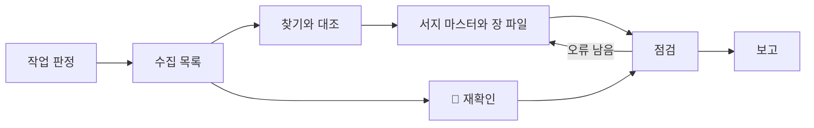

# researching-chapter: 출처 수집과 대조 절차

이 스킬은 원고가 쓸 사실마다 확인된 근거 하나씩을 붙이는 절차입니다. 결과물은 서지 마스터 `docs/references-master.yml`의 항목, 장 폴더 `references.yml`(장 파일)의 키와 인용 내용, `notes.md`의 리서치 보고, 그리고 🔄 관리표 갱신 제안이에요. 세부 규칙은 `references/`에 있고, 이 파일은 각 단계에서 무엇을 언제 열지만 알려 줍니다.

이 스킬이 지키는 원칙은 하나입니다. 열어서 확인하지 못한 것은 적지 않습니다(CLAUDE.md 8장). 출처가 비어 있는 원고는 `[출처 필요]`로 버틸 수 있지만, 존재하지 않는 논문이 실린 책은 되돌릴 수 없기 때문입니다.

## 1. 언제 쓰는가, 쓰지 않는가

쓰는 경우
- 장 리서치: 장 집필 사이클 ①(tasks.md 6장). 그 장 파일 `references.yml`과 서지 마스터 항목 초안, 🔄 재확인
- `references.yml` 초기화: 설계서 출처 마스터 목록의 서지를 서지 마스터로, 장 "출처 키" 줄을 장 파일로 옮기기(tasks.md 4.4절)
- 🔄 관리표 재확인: 한 장 또는 한 권 전체(tasks.md 4.5절)
- 키 몇 개, 수치 하나의 근거 확인("이 수치 출처 있어?")
- writer나 reviewer가 남긴 `[출처 필요]` 태그와 미등록 `[@key]` 처리

쓰지 않는 경우

| 작업 | 맡는 곳 |
|---|---|
| 원고(`index.md`) 쓰기와 고치기, `[@key]`를 원고에 넣기 | writing-chapter 스킬(writer) |
| 그림, 캡션 출처 줄, `figures.yml` | making-figures 스킬 |
| 출처 확정(`status: verified`) | 사람(저자) |
| 🔄 관리표, 설계서, 정본 수정 | 저자 승인 뒤 메인 에이전트 |
| 완료 판정, 사실 정확성 평가 | reviewer 에이전트 |

## 2. 절차 한눈에 보기

| 단계 | 산출물 | 이때 여는 reference |
|---|---|---|
| 0. 작업 판정 | 장 리서치 / 초기화 / 🔄 재확인 / 키 확인 | 없음 |
| 1. 수집 목록 | 키와 사실마다 한 줄인 목록 | `sources-and-verification.md` 2장 |
| 2. 찾기와 대조 | 출처마다 tier, check, 원문 위치 | `sources-and-verification.md` 1, 3~8장 |
| 3. 서지 마스터와 장 파일 쓰기 | 서지 마스터 항목, 장 파일의 키와 `claims` | `references-schema.md` |
| 4. 🔄 재확인 | 요약표와 제안 카드 | `refresh-proposal.md` |
| 5. 점검 | 서식 점검 OK, 키 대조 결과 | `references-schema.md` 9장, `research-report.md` 7장 |
| 6. 보고 | `notes.md` 리서치 보고, 응답 요약 | `research-report.md` |

초기화는 1, 3, 5, 6단계만 합니다. 🔄 재확인만 하는 작업은 1, 4, 6단계예요.

## 3. 단계별 절차

### 0단계: 작업 판정

요청에서 작업 종류와 대상(권, 장, 키)을 정합니다. 권 폴더는 `vol1-llm/`, `vol2-agent/`, `vol3-physical-ai/`이고 장 번호는 두 자리(`ch04`)입니다. "4장 출처 봐 줘"가 리서치 전체인지 키 확인인지 애매하면 장 리서치로 보고 시작하되, 보고서 범위 줄에 그렇게 판단했다고 적어요.

웹 검색과 페이지 열기 도구가 있는지 먼저 확인합니다. 없으면 존재 대조를 할 수 없으므로 초기화만 하고, 그 사실을 보고서 첫 줄에 적습니다(`sources-and-verification.md` 8장).

### 1단계: 수집 목록

**열 것**: `references/sources-and-verification.md` 2장. 해당 권 설계서에서 아래 순서로 읽고 목록을 만듭니다.

1. 5장 그 장 설계: "출처 키" 줄, 절 목차 칸의 괄호 키, "🏭 사례 후보", 메타의 "🔄 비중"
2. 7장 숫자 정본: 이 장 행 가운데 출처 키가 붙은 값
3. 🔄 관리표(1권 9장, 2, 3권 10장): 위치 칸에 이 장 절이 있는 행
4. 출처 마스터 목록(1권 12장, 2, 3권 12장): 위 키들의 행과 상태 기호
5. 서지 마스터에 이미 있는 키(다른 장이나 앞 권이 넣은 항목)
6. 장 폴더의 `references.yml`, `notes.md`, 원고가 있으면 `index.md`의 `[출처 필요]`와 `[@key]`

목록에는 "무엇을 받칠지"를 함께 적습니다. 키 이름만 있는 목록으로는 원문에서 무엇을 찾아야 할지 알 수 없어요.

### 2단계: 찾기와 대조

**열 것**: `references/sources-and-verification.md`. 1장 우선순위로 출처를 고르고, 3장 표대로 존재를 대조하고, 4장대로 사실과 숫자의 원문 위치를 찾습니다. 언론 숫자는 5장 교차 확인을 거칩니다.

- 설계서에 키가 있는 출처부터 대조합니다. 새 출처는 설계서 키로 받칠 수 없는 사실에만 찾아요.
- 원문을 열 때마다 열람일을 적어 둡니다. 3단계 `accessed`의 값입니다.
- 판정이 갈리면 6장 표대로 처리하고, 설계서와 정본은 고치지 않습니다.
- 존재를 확인하지 못한 것은 7장대로 기록하지 않고 "찾지 못함"에 모읍니다.

### 3단계: 서지 마스터와 장 파일 쓰기

**열 것**: `references/references-schema.md`. 1장 두 파일의 역할, 2장과 3장 필드 표, 7장 예시를 보고 씁니다.

- 서지(제목, 저자, 연도, 주소, `kind`, `tier`, `check`, `status`, `accessed`, `note`)는 서지 마스터 `docs/references-master.yml`에만 씁니다. 키의 알파벳 순서 자리에 넣어요.
- 다른 장 리서치와 병렬로 도는 실행이면 서지 마스터를 고치지 않습니다. 넣거나 고칠 항목을 리서치 보고 끝 "서지 마스터 반영 대기" YAML 블록(서지 마스터 항목과 같은 꼴)으로 남기고, 장 파일과 보고만 씁니다. 메인 에이전트가 한 번에 하나씩 반영하고 5단계 서식 점검을 다시 돌립니다(CLAUDE.md 13장 "쓰기는 한 번에 하나").
- 장 파일 `vol*/chNN/references.yml`에는 `key`와 `claims`(이 장이 받치는 사실, 쓰일 절, 원문 위치)만 쓰고, 이 장에만 해당하는 주의는 장 파일 `note`에 둡니다. 서지 필드를 장 파일에 복사하지 않습니다.
- 키가 서지 마스터에 이미 있으면 항목을 새로 만들지 않고 장 파일에 키와 `claims`만 넣습니다. 원문을 다시 열었으면 서지 마스터의 `accessed`와 `check`를 고쳐요.
- 키는 설계서 마스터 목록 철자 그대로입니다. 새 키는 6장 규칙으로 짓고 보고서의 "새 키 제안"에 올려요.
- 설계서 ✅/◐/⚠는 `check`(matched, unchecked, secondary)로 옮기고, `status`는 모든 항목을 `unverified`로 둡니다(5장 대응표). `status`는 사람 확인 여부만 나타냅니다.
- `accessed` 기본값: 설계서 ✅를 다시 열지 못했으면 `2026-10-12`(설계서 대조일). 2권 ✅에는 "설계서 2권 12장: 검색 결과로 대조, 원문 재확인 권장" `note`를 자동으로 붙입니다.
- 이미 `status: verified`인 항목은 서지를 바꾸지 않습니다. 다르게 보이는 점은 보고서에 적어요.
- 숫자를 받치는 줄은 `claims`에 원문 값, 위치, 조건을 적습니다. 원문 위치를 찾지 못했으면 `locator: "확인 못 함"`으로 두고 사람 확인 요청에 올립니다.
- 원고가 논문 설정값(층 수, 칸 수, 헤드 수)을 쓸 자리면 그 값과 원문이 적은 관계("512 = 8 × 64")를 `value`에 적습니다. 원문에 없는 계산(√64 = 8)은 claim에 넣지 않아요. 그런 숫자는 출처 사실이 아니라 정본 몫입니다(`writing-chapter/references/self-check.md` C1).
- `where`는 그 키가 실제로 쓰일 자리마다 둡니다. 같은 키라도 박스 사례용 claim만 있으면 본문 절의 숫자를 받치지 못해요. 1권 4장 R1 치명 지적(BERT 두 모델 문장)은 "4장 사례 ②" claim만 있는 키를 4.5절 숫자에 붙인 데서 나왔습니다.

### 4단계: 🔄 재확인

**열 것**: `references/refresh-proposal.md`. 1장으로 대상 행을 고르고, 2장 절차로 확인한 뒤, 3장 판정과 4장 서식으로 적습니다.

- 대상 행이 없으면 "이 장 🔄 행 없음"을 보고서에 적고 넘어갑니다.
- 더 새로운 정보를 찾아도 관리표, 원고, 정본은 고치지 않고 제안 카드만 씁니다.
- 묶인 행(1권 9장과 3권 10장의 EU AI Act처럼)은 같은 카드에 함께 올립니다.

### 5단계: 점검

`.venv/bin/python scripts/check_references.py vol1-llm/ch04` 한 번으로 서식 점검과 키 대조를 함께 합니다. 결과를 보고서에 붙여요. 원고가 이미 있으면 `writing-chapter/references/self-check.md` 명령 G-9도 돌려, `[@key]` 자리마다 그 자리 claim이 있고 문장의 숫자가 claim에 있는지 봅니다. 출력된 줄은 claim을 더하거나(원문을 열어 확인한 것만) 보고서 "원고 수정 제안"으로 writer에게 넘깁니다.

1. 서식 점검(REF-M, REF-C, 규칙 뜻은 `references-schema.md` 9장): 서지 마스터의 필수 필드와 값, 장 파일 키가 서지 마스터에 있는지, 장 파일에 서지 필드가 복사되지 않았는지를 봅니다. 요약 줄 끝이 `OK`이고 오류가 0일 때까지 3단계로 돌아가 고칩니다.
2. 키 대조(REF-D, REF-B, 표는 `research-report.md` 7장): "빠짐"(D01)과 "추가"(D02)마다 보고서 4장이나 5장에 설명이 있어야 하고, "마스터에 없음"(C03)은 0줄이어야 합니다. "미사용"(REF-X01)은 인자 없이 전체를 돌릴 때만 나오며, 이번 장 키와 관계있으면 보고서에 처리 방안을 적습니다.

그리고 아래를 눈으로 확인합니다.
- [ ] 서지 마스터에서 이번에 넣거나 고친 항목이 모두 `status: unverified`이고, 사람이 이미 확인한 `verified` 항목은 그대로다
- [ ] `url`이 실제로 연 주소이고, 자리 표시나 기억으로 채운 값이 없다
- [ ] 숫자를 받치는 `claims`마다 `value`와 `locator`가 있다
- [ ] `tier: 4` 숫자에 `claims.crosscheck`가 있거나 "원고에 쓰지 말 것"이 보고돼 있다
- [ ] 우리가 쓴 글(`what`, `conditions`, `note`, 보고서, 제안 카드)에 금지 기호가 없다

### 6단계: 보고

**열 것**: `references/research-report.md`. 1~9장 서식으로 장 `notes.md` 끝에 `## 리서치 보고 (YYYY-MM-DD)` 절을 붙이고, 10장의 다섯 줄 요약을 응답으로 돌려줍니다. "사람 확인 요청"은 비워 두지 않습니다. 에이전트가 `matched`로 대조한 항목도 사람이 확인해야 확정되기 때문이에요.

## 4. 출력 파일

| 파일 | 내용 | 만드는 단계 |
|---|---|---|
| `docs/references-master.yml` | 이번에 넣거나 고친 출처의 서지 항목 | 3 |
| `vol*/chNN/references.yml` | 이 장이 인용하는 키와 `claims` | 3 |
| `vol*/chNN/notes.md` | 끝에 `## 리서치 보고 (YYYY-MM-DD)` 절 추가. 기존 절(입력 메모, 절 개요, 자가 점검 보고)은 그대로 두고 덧붙이기만 함(`research-report.md` 1장) | 6 |
| 응답 | 다섯 줄 요약 | 6 |

그 밖의 파일(원고, 설계서, 관리표, `docs/volatile.yml`, `docs/figures.yml`)은 읽기만 합니다. `docs/volatile.yml`의 `checked_at`은 저자 승인 뒤 메인 에이전트가 씁니다.

## 5. 하지 않는 일

| 하지 않는 일 | 대신 할 일 | 이유 |
|---|---|---|
| 원고 쓰기와 고치기 | 보고서 키 표의 "원고에서" 칸으로 writer에게 넘김 | 원고는 설계서와 정본만으로 쓰는 writer의 몫입니다(CLAUDE.md 13장) |
| 출처 확정(`status: verified`로 올리기) | 사람 확인 요청 목록에 올림 | 에이전트가 찾은 출처는 사람이 확인한 뒤에만 확정합니다(CLAUDE.md 8장) |
| 존재를 확인하지 못한 논문, 링크, 수치 기록 | "찾지 못함"에 찾아본 곳과 함께 적음 | 기억에서 나온 서지가 가장 흔한 사고 원인입니다 |
| 🔄 관리표 직접 수정 | 제안 카드 작성 | 관리표 한 칸이 원고, 그림, 정본, 다른 권 표와 묶여 있습니다 |
| 설계서 마스터 목록, 정본 수정 | 새 키 제안, 설계서와 다른 점 표 | 설계서가 검수 기준이라 승인 뒤에만 바뀝니다(CLAUDE.md 2장) |
| 키 이름 새로 짓기(목록에 있는 출처) | 설계서 키 그대로 | 원고 `[@key]`와 그림 `source.refs`가 같은 이름을 씁니다 |
| 장 파일에 서지 복사 | 서지는 서지 마스터에 한 번만, 장 파일은 키와 `claims` | 복사본이 생기면 한쪽만 고쳐져 서지가 어긋납니다 |
| 서지 마스터에서 남의 장 키 지우기 | "미사용"을 보고서에 적음 | 다른 장이 곧 쓸 키이거나 사람이 확인한 항목일 수 있습니다 |
| 언론 숫자를 교차 확인 없이 적기 | 원문 찾기, 독립 보도 대조, 갈리면 쓰지 않음 | CLAUDE.md 8장 출처 우선순위 |
| 긴 직접 인용 옮기기 | 요지를 우리말로 `what`에 | 직접 인용은 최소화합니다(계획서 11장) |
| 일정, 마감 적기, 문서 버전 올리기 | 하지 않음 | CLAUDE.md 2장 |

## 6. 막혔을 때

사실, 날짜, 수치가 모호하면 추측으로 채우지 말고 묻습니다. 질문에는 무엇이 모호한지, 어디까지 확인했는지(연 페이지, 판), 선택지가 무엇인지를 함께 적어 주세요.

자주 막히는 지점
- 원문이 유료이거나 접근이 막힘: 서지 마스터 `check`를 올리지 않고 사유를 `note`에 적은 뒤 사람 확인 요청 앞쪽에 둡니다
- 설계서 키가 가리키는 자료가 둘 이상으로 보임: 키를 고치지 않고 보고합니다
- 사례 후보 모두 출처를 못 찾음: 후보 밖 사례를 고르지 않고, 설계서 사례 후보 교체를 제안합니다
- 원문 숫자와 정본 숫자가 다름: 정본을 고치지 않고 "설계서와 다른 점"에 올립니다
- 같은 사실의 🔄 행이 두 권에 있고 값이 어긋남: 충돌 카드로 올립니다
