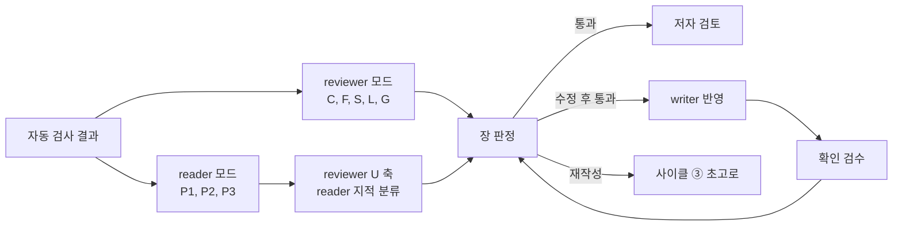

# reviewing-chapter: 독립 검수 절차

이 스킬은 장 집필 사이클 ⑥ "독립 검수"(CLAUDE.md 4장, tasks.md 6장)의 절차입니다. 원고를 쓴 쪽이 아닌 눈으로 읽고, 고칠 곳을 **고칠 수 있는 단위**로 적어 넘기는 것이 목표예요. 그래서 이 스킬의 산출물은 수정된 원고가 아니라 보고서이고, 보고서의 지적마다 ID, 위치, 심각도, 수정 방향이 붙습니다.

세부 서식과 판정 규칙은 `references/`에 있습니다. 이 파일은 모드별로 무엇을 언제 열지만 알려 드려요.

## 1. 언제 쓰는가, 쓰지 않는가

쓰는 경우
- 장 전체 검수: `vol*/chNN/index.md` 초고가 자동 검사(사이클 ⑤)를 마친 뒤
- 절 하나 검수: 시험 운전(tasks.md 3.8절)이나 장 일부만 먼저 볼 때
- 확인 검수: "수정 후 통과" 판정을 받은 원고를 writer가 고친 뒤, 지적 ID별로 반영을 확인할 때
- 부 도입, 앞부분, 0장, 맺음말: 장 템플릿 항목을 빼고 같은 축으로 봅니다

쓰지 않는 경우

| 작업 | 맡는 곳 |
|---|---|
| 원고 쓰기, 고치기, 지적 반영 | `writing-chapter` (writer) |
| 그림 제작과 수정, `figures.yml` 상태 변경 | `making-figures` (writer) |
| 출처 찾기와 대조, `references.yml` 작성 | researcher (`researching-chapter`) |
| 작성자의 넘기기 전 점검 | `writing-chapter`의 `references/self-check.md` |
| 현장 노트 칼럼 판정 | 저자. 검수는 일반화 규칙 위반만 봅니다 |

## 2. 두 모드

| | reviewer 모드 | reader 모드 |
|---|---|---|
| 누가 | reviewer 에이전트 | reader 에이전트 |
| 하는 일 | 완료 기준 체크, 6개 축 평가(C, F, U, S, L, G), 수정 제안, 장 판정 | P1, P2, P3로 세 번 읽고 막힘, 걸림, 의문 표시, 읽기 판정 |
| 기준 | 설계서 13~15장, 정본, `scenario-hanbit.yml`, 관리표, `qa-checklist.md` | `docs/reader-profile.md` 2~8장, 9.3절 점검표, `docs/difficulty-map.yml` |
| 읽는 것 | 원고, 작업 노트, 설계서, 정본, 출처, 그림 PNG, reader 보고서 | 원고, 앞 장 원고, `glossary.yml`(정의 위치 확인용), 독자 프로파일 |
| 읽지 않는 것 | 없음 | 설계서 정본 표와 출처 원문. 독자가 갖지 않은 정보로 읽으면 막힘을 놓칩니다 |
| 하지 않는 일 | 원고 직접 수정, 자기 원고 검수, 대체 문단 쓰기 | 원고 직접 수정, 사실 정확성 판정, 대체 문장 쓰기 |
| 보고서 | `references/reviewer-report.md` | `references/reader-report.md` |

축 코드: C 완료 기준, F 기술 사실 정확성, U PM 독자 이해도, S 금지 기호 외 문체, L 서술 수위, G 그림. CLAUDE.md 4장이 요구하는 "기술 사실 정확성"과 "PM 독자 이해도"의 따로 평가는 F 축과 U 축의 등급으로 남깁니다.

## 3. 독립성 규칙

검수자는 검수 대상의 집필, 그림 제작, 자가 점검에 참여하지 않았어야 합니다(CLAUDE.md 13장). 작성자는 자기가 의도한 뜻으로 읽기 때문에 빠진 전제를 보지 못해요.

- 시작 전에 확인합니다: 이 대화나 이 에이전트 실행에서 대상 원고, 그 장 그림, `notes.md`, `eli5.md`를 쓰거나 고쳤는가? `notes.md` 자가 점검 보고의 작성자가 나인가?
- 하나라도 예면 검수하지 않고 "독립성 미충족: 다른 에이전트 실행으로 검수 필요"라고 보고한 뒤 멈춥니다.
- 확인 검수(2회차 이후)는 같은 reviewer가 해도 됩니다. 다만 반영 과정에서 원고를 고친 적이 있으면 안 됩니다.
- reviewer와 reader는 서로 다른 실행이어야 합니다. reader 결과를 reviewer가 쓰는 구조라서, 한 실행이 둘을 겸하면 U 축이 자기 확인이 됩니다.
- 보고서 머리의 "독립성" 줄에 확인 결과를 적습니다.

## 4. 흐름

reader를 먼저 돌리고 reviewer가 그 보고서를 받아 U 축에 넣는 순서가 기본입니다(`reader-profile.md` 9.3절). reviewer의 F, L, G 축은 reader 결과와 무관하므로 동시에 시작해도 됩니다.

확인 검수(R2 이후)는 순서를 지킵니다. 직전 회차에 최상 개념 절 막힘(M1)이 있었으면 reader를 먼저 끝내고, reviewer는 그 reader 보고서를 입력으로 받아 M1을 판정합니다. 1권 4장은 R1, R2 모두 둘을 동시에 돌려 reviewer가 두 번 다 "M1 미확인"으로 냈고, R2 장 판정이 "통과 (M1 미확인)"로 남았어요. 시간 때문에 동시에 돌렸다면 메인 에이전트가 아래 순서로 M1을 닫습니다.

1. reader 보고서 판정 표의 "최상 절 막힘"이 0이고, 직전 막힘 ID마다 같은 페르소나로 다시 읽어 닫았다는 기록이 있는지 봅니다(`verdict-rules.md` 3.6절).
2. 둘 다 있으면 reviewer 판정의 "(M1 미확인)"이 풀린 것으로 보고, `notes.md` 검수 반영 기록 끝에 "M1 닫힘: reader-r{N}.md 1장, R{N-1}-P1-01" 한 줄을 적습니다. 보고서 파일은 고치지 않아요.
3. reader가 최상 절에 새 막힘을 적었으면 장 판정은 수정 후 통과로 바뀝니다. 이때는 reviewer를 같은 회차로 다시 부르지 않고 다음 회차 확인 검수로 넘깁니다.

메인 에이전트가 검수를 부르는 문구는 아래 꼴을 씁니다. 페르소나 읽기 경로는 문구로 바꾸지 않습니다. 4장 R1에서 요청이 "1~3장을 읽은 독자"로 경로를 넓혔는데 reader가 스킬대로 P3를 2장만 읽은 독자로 읽어, 요청과 보고서 머리가 어긋났어요.

| 대상 | 호출 문구 예 |
|---|---|
| reader | "reviewing-chapter 스킬 reader 모드로 vol1-llm/ch04/index.md R2 확인 검수. 읽기 경로는 `reader-profile.md` 1.1절을 따름. 직전 보고서 review/reader-r1.md, 최상 절 막힘 R1-P1-01을 P1, P3로 다시 읽어 닫힘 여부를 적을 것. 보고서는 review/reader-r2.md" |
| reviewer | "reviewing-chapter 스킬 reviewer 모드로 vol1-llm/ch04 R2 확인 검수. 직전 보고서 review/reviewer-r1.md, 반영 기록 notes.md, reader 보고서 review/reader-r2.md(U 축과 M1 근거). 보고서는 review/reviewer-r2.md" |

## 5. 입력

| 입력 | reviewer | reader | 없을 때 |
|---|---|---|---|
| 원고 `vol*/chNN/index.md` (절 검수면 그 절) | 필수 | 필수 | 검수하지 않음 |
| 앞 장 원고 | 정의와 참조 확인 | 앞 장을 읽은 독자로 읽기 | 설계서 장 간 의존 관계로 대체(reviewer만) |
| 자동 검사 결과(`bash scripts/check_chapter.sh`: `style_check`, `check_canon`, `check_figures`, `verify_examples`, `check_references`, `page_estimate`) | 필수, 다시 돌림 | 참고 안 함 | 스크립트를 못 쓰면 `self-check.md` 예비 명령 |
| `notes.md` 자가 점검 보고 | 보고 항목과 검사 수단만 참고 | 읽지 않음 | 보고서에 "자가 점검 보고 없음"을 C 축 중대로 |
| 해당 권 설계서: 그 장 설계, 7장 정본, 비유 고정표, 🔄 관리표, 서술 수위 절, 완료 기준 장 | 필수 | 읽지 않음 | |
| `docs/scenario-hanbit.yml`, `docs/glossary.yml` | 필수 | glossary만, 정의 위치 확인용 | 설계서 8장, 11장으로 대체 |
| `references.yml` | 필수 | 읽지 않음 | 출처 키 전부 "보고" |
| `figures/`, `docs/figures.yml`, 미리보기 PNG | 필수, PNG 다시 만듦 | 원고에 보이는 그림 줄만 | 그림 파일 없음은 "보고" |
| `docs/reader-profile.md`, `docs/difficulty-map.yml` | U 축 근거 | 필수 | |
| reader 보고서 | U 축 필수 | 해당 없음 | U 축을 reviewer 혼자 평가하고 "reader 결과 없음"을 적음 |

## 6. reader 모드 절차

**열 것**: `references/reader-report.md`, `docs/reader-profile.md` 9.3절.

1. 독립성을 확인하고 대상(장 또는 절, 회차)을 정합니다.
2. 난도 지도에서 이 장 개념을 찾고, 지도에 오른 절부터 그 개념의 첫 페르소나로 읽습니다.
3. 페르소나마다 그 페르소나의 "이미 아는 것"만 들고 처음부터 끝까지 읽어요. 3권을 읽는 P3라면 1권 2, 4, 9장과 3권 0장만 읽은 독자입니다(`reader-profile.md` 1.1절 읽기 경로). 요청 문구가 다른 경로를 주면 스킬의 경로를 따르고, 보고서 머리 "읽기 경로" 줄 아래에 요청과 다른 점을 한 줄 적습니다.
4. 절마다 9.3절 점검표 12항목을 던지고, 걸리는 곳을 표시 형식대로 적습니다. 사실이 맞는지는 보지 않아요. 숫자가 앞뒤로 안 맞아 헷갈리면 "의문"으로 "헷갈린 이유"만 적습니다.
5. 페르소나별 집계와 가장 많이 막힌 절 3개를 내고, `references/verdict-rules.md` 4장으로 읽기 판정을 냅니다.

## 7. reviewer 모드 절차

**열 것**: `references/reviewer-report.md`(보고서 서식과 축별 점검), `references/verdict-rules.md`(심각도, ID, 판정).

1. **준비**: 독립성 확인, 대상과 회차 확정, 5장 입력을 펼칩니다. 확인 검수면 직전 보고서와 `notes.md`의 검수 반영 기록을 함께 엽니다.
2. **자동 검사 재실행**: 작성자의 결과를 믿지 않고 `bash scripts/check_chapter.sh vol1-llm/ch04`(장 완료 판정 회차는 `--final`)로 다시 돌려 수치를 적고, 출력 끝의 보고서 한 줄을 보고서 머리 "검사 수단" 칸에 그대로 붙입니다. 걸린 항목은 개별 스크립트(`--help` 참고)로 다시 봅니다. 스크립트를 못 쓸 때만 `writing-chapter/references/self-check.md`의 예비 명령을 씁니다. 금지 기호, 어미 비율, 100자 초과는 이 단계의 수치로만 판정하고 S 축에서 다시 세지 않습니다.
3. **C 축**: 완료 기준 표(1권 13장, 2권 14장, 3권 15장)를 한 줄씩 판정합니다. 항목마다 `self-check.md`의 대응 ID가 보고서 서식에 있어요.
4. **F 축**: 숫자, 세계관 값, 출처 키, 🔄, 개념 설명, 성능 주장을 봅니다. 근거(정본 ID, 설계서 절, 출처 키)를 댈 수 있을 때만 치명으로 적고, 근거가 없는 의심은 "확인 요청"으로 남깁니다.
5. **L 축**: 보안(2권 13.4절), 로봇 안전(3권 14.4절) 문단이 있으면 판정합니다. 없으면 "해당 없음".
6. **G 축**: `making-figures/references/qa-checklist.md` 6장 reviewer 방식대로 `.venv/bin/python scripts/figure_qa.py vol1-llm/ch04 --sheet`로 PNG를 다시 만들어 Q1~Q27을 봅니다. 원고 안 그림 줄(캡션, 대체 텍스트, 본문 참조)도 여기서 봅니다.
7. **S 축**: 자동 검사가 못 잡는 문체를 봅니다(어미의 자리, 직역투, 리듬, 굵은 글씨의 쓰임, 표기 통일).
8. **U 축**: reader 지적을 채택, 병합, 기각으로 분류하고, reviewer 자신의 이해도 점검(질문 3개의 답, 3단 설명, 비유 한계, 🧭 박스)을 더합니다. 최상 개념 절의 막힘은 낮추지 않고 M1(`verdict-rules.md` 3.6절)로 따로 셉니다.
9. **판정**: `verdict-rules.md` 3장 규칙으로 축별 등급과 장 판정을 냅니다.
10. **보고**: 보고서를 저장하고 사용자에게 판정, 치명과 중대 수, 재작성 사유(있으면), 저자 확인 항목을 요약합니다.

## 8. 판정 등급 한눈에

| 등급 | 조건 요약 | 다음 단계 |
|---|---|---|
| 통과 | 치명 0, 중대 0, 최상 개념 절 reader 막힘 0 | 사이클 ⑦ 저자 검토. 경미 지적은 writer가 반영 여부를 고름 |
| 수정 후 통과 | 재작성 조건에 안 걸리고 치명이나 중대가 1개 이상, 또는 최상 개념 절에 막힘이 남음(M1) | writer가 치명, 중대를 모두 반영하고 반영표 작성, 확인 검수 |
| 재작성 | "절" 범위 지적 1개 이상, 치명 5개 이상 등 `verdict-rules.md` 3.2절 조건 | 사이클 ③(구조 문제면 ②)으로. 다음 회차는 전면 검수 |

정확한 조건과 숫자는 `references/verdict-rules.md`에 있습니다. 문턱값(치명 5개, 절 검수 3개, 한 절 치명과 중대 8개, 최상 절 막힘 3개, 장 전체 막힘 15개)은 저자가 확정한 초기값이고, 시험 운전(tasks.md 3.8절)에서 다시 맞출 수 있어요. 한 문제가 두 축에 걸치면 주 축 한 곳에서만 세고 다른 축은 ID로 가리킵니다(`verdict-rules.md` 2.4절).

## 9. 출력 파일

| 파일 | 내용 | 쓰는 쪽 |
|---|---|---|
| `vol*/chNN/review/reader-r{N}.md` | reader 보고서 | reader |
| `vol*/chNN/review/reviewer-r{N}.md` | reviewer 보고서와 장 판정 | reviewer |
| `vol*/chNN/notes.md`의 "검수 반영 기록" | 지적 ID별 조치(반영, 부분 반영, 이견, 저자 확인) | writer |

- `{N}`은 회차입니다. 1회차가 `r1`, 확인 검수가 `r2`예요. 절 검수는 `reviewer-r1-s6.5.md`처럼 절 번호를 붙입니다.
- 보고서는 고치지 않고 쌓습니다. 회차마다 새 파일을 만들어야 지적이 언제 나와 언제 닫혔는지 남습니다.
- reviewer와 reader는 `notes.md`를 읽기만 합니다. writer와 researcher도 그 파일에는 끝에 덧붙이기만 하므로, 검수자가 입력으로 쓸 절 개요와 반영 기록이 회차를 넘어 남아 있어야 합니다.
- `review/` 폴더는 작업 노트라 빌드에서 뺍니다(CLAUDE.md 3장 구조도, 저자 확정).
- 시험 운전과 평가 사례에서는 원고 폴더 대신 작업 폴더의 `outputs/` 아래 같은 상대 경로로 저장합니다(`evals/README.md`).

## 10. 하지 않는 일

| 하지 않는 일 | 대신 할 일 | 이유 |
|---|---|---|
| 원고, 그림, `figures.yml`, `references.yml` 고치기 | 지적 ID와 수정 방향만 적음 | 검수자가 고치면 그 부분은 다시 독립 검수를 받지 못합니다 |
| 자기 원고나 자기 그림 검수 | 독립성 미충족으로 보고하고 멈춤 | CLAUDE.md 13장 |
| reviewer가 대체 문단 쓰기 | 틀린 값이면 맞는 값과 근거(정본 ID)까지만, 문장은 방향만 | 문장을 쓰는 순간 검수자가 작성자가 됩니다 |
| reader가 사실 판정하기 | 헷갈린 이유만 "의문"으로 | 독자는 정본을 모릅니다. 사실은 reviewer F 축 몫이에요 |
| 근거 없이 치명 판정 | "확인 요청"으로 남기고 researcher나 저자에게 | 근거 없는 치명은 맞는 원고를 재작성으로 보낼 수 있습니다 |
| 출처를 확정하거나 `status`를 바꾸기 | unverified 키를 "보고"로 셈 | 사람이 확인해야 확정됩니다(CLAUDE.md 8장) |
| 정본, 설계서와 다른 기준으로 판정 | 기준이 이상하면 설계서 수정 제안으로 따로 적음 | 원고는 설계서를 따랐을 뿐이에요 |
| `approved` 판정, 장 완료 체크 | 판정까지만. 완료는 저자 승인 뒤 | tasks.md 0.1절 👤 규칙 |
| 일정, 마감 적기, 문서 버전 올리기 | 쓰지 않음 | CLAUDE.md 2장 |

## 11. 막혔을 때

- 설계서끼리 다르거나 원고가 설계서의 오류를 그대로 따른 경우: 원고 지적이 아니라 "설계서 확인" 항목으로 적고 판정에서 뺍니다.
- 정본 값이 실제 계산과 다르다고 보일 때: 원고 지적이 아니라 정본 확인 요청으로 올립니다. 원고는 정본을 따랐으면 맞아요.
- 심각도가 두 등급 사이에서 애매하면 낮은 쪽으로 적고 "판단 근거" 칸에 이유를 씁니다. 같은 망설임이 반복되면 `verdict-rules.md` 개정 제안으로 모읍니다.
- 그림 파일이 아직 없으면 G 축은 원고의 그림 줄만 보고, 그림 자체는 "보고"로 남깁니다.
- 판단할 수 없는 사실은 추측으로 판정하지 말고 무엇을 어디서 확인하려 했는지와 함께 사용자에게 묻습니다.
